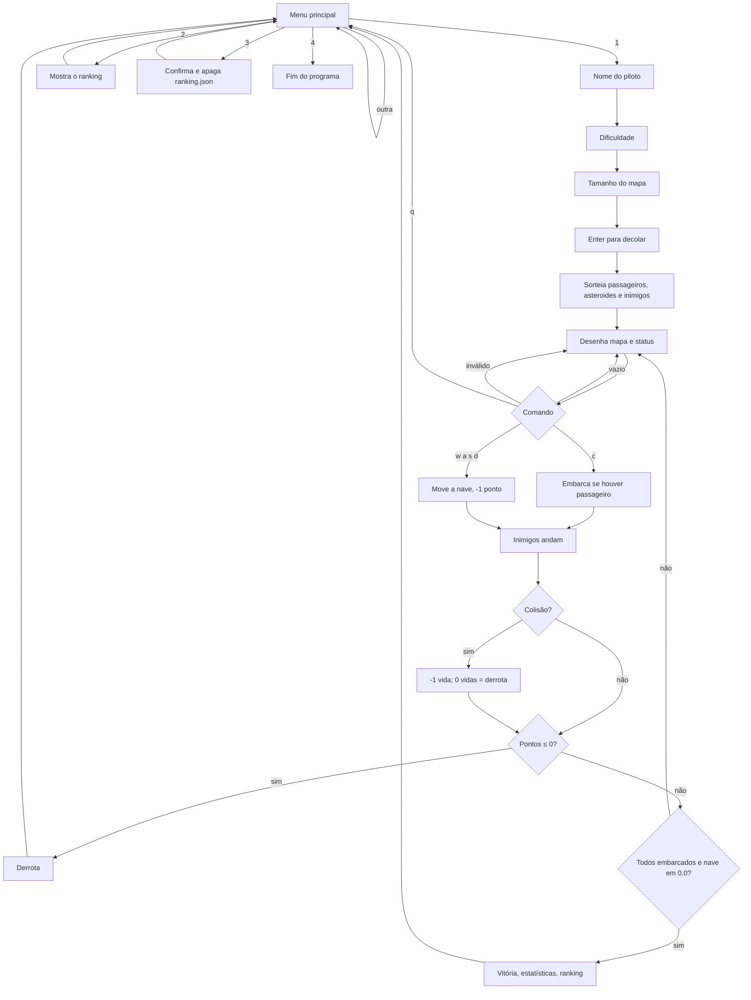
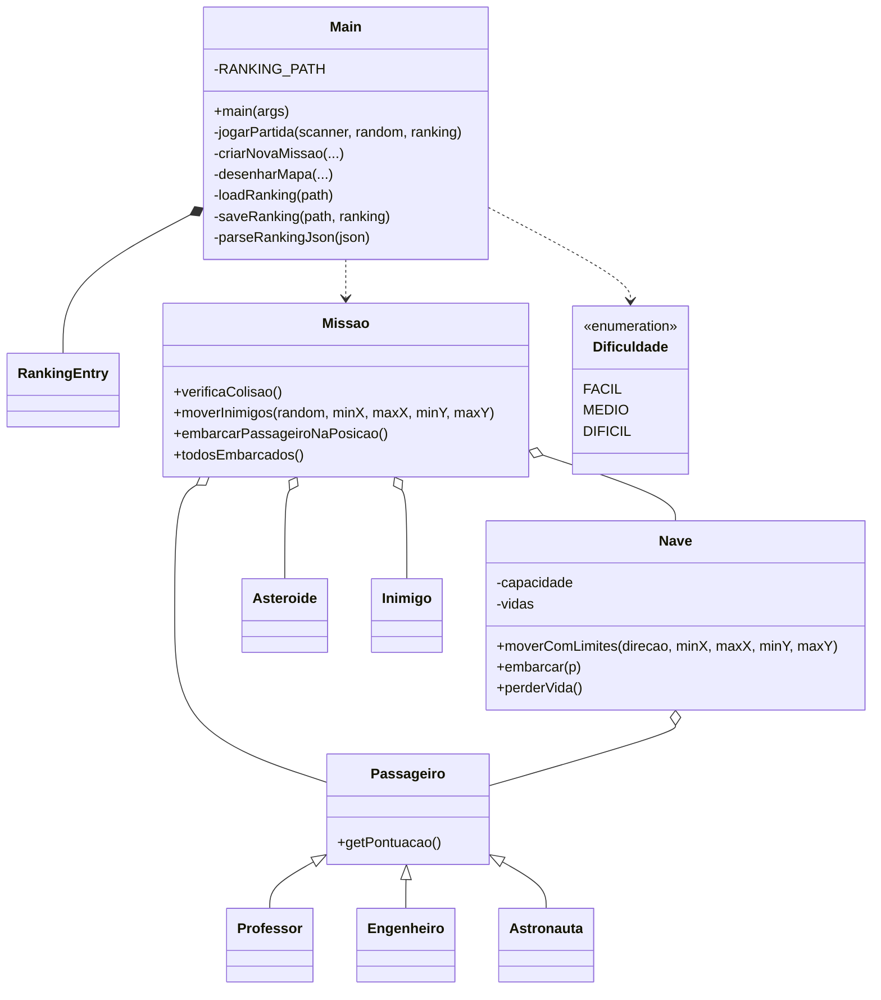
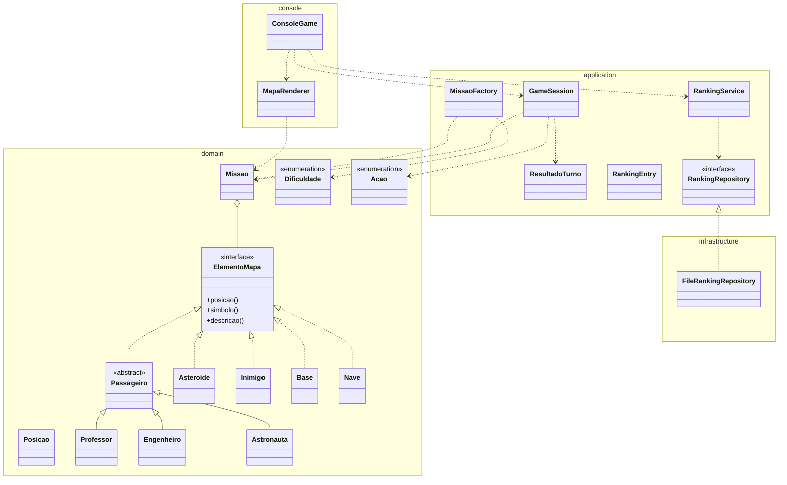

# Diagnóstico da fase 0 (MM-01)

Este documento registra como o jogo de console original funciona antes da refatoração: como rodar, as classes, o fluxo de uma partida, os acoplamentos e a lista de comportamentos que a fase 1 precisa preservar. As referências `Arquivo.java:linha` apontam para `fases/fase-00-console/src`.

## 1. Como rodar

Na pasta `fases/fase-00-console`, no Git Bash, com JDK 17 ou mais novo:

```bash
javac -encoding UTF-8 -d out src/*.java
java -Dstdout.encoding=UTF-8 -cp out Main
```

- `-Dstdout.encoding=UTF-8` só é necessário quando a saída é redirecionada para arquivo (sem ele o Java grava em Cp1252 e os acentos quebram).
- Para repetir uma partida sem digitar, a entrada vem de arquivo: `java -Dstdout.encoding=UTF-8 -cp out Main < docs/entrada-partida.txt`. Pelo pipe do PowerShell 5.1 a entrada chega com o acento corrompido, por isso usamos o Git Bash.
- O jogo usa `new Random()` sem semente (`Main.java:28`): cada execução sorteia um cenário diferente.

### Partida executada (21/11/2026, JDK 25, Git Bash)

Entrada (`docs/entrada-partida.txt`): opção 1, piloto `Ana`, `facil`, mapa `3`, Enter para decolar, depois `d`, `x`, linha vazia, `c`, `s`, `q`, e no menu `2` (ranking) e `4` (sair). Saída completa em `docs/saida-partida.txt`. Resumo:

```text
Iniciando missão na dificuldade Fácil...
Mapa da Missão (Pontos: 30) - Piloto: Ana
     -3 -2 -1  0  1  2  3
 -3|  .  .  .  .  .  #  .
 -1|  .  .  .  P  .  .  .
  0|  .  .  .  @  .  .  .
  2|  .  .  .  P  X  .  .
  3|  .  .  E  .  .  .  E
Nave em (0,0) | Pontos: 30 | Vidas: 3 | A bordo: 0/5 | Restantes: 4
Comando: d   -> Nave em (1,0) | Pontos: 29            (movimento custa 1 ponto)
Comando: x   -> Comando inválido.                      (nada se move, pontos iguais)
Comando: ""  -> o mapa é redesenhado, nada muda       (entrada vazia é ignorada)
Comando: c   -> Nenhum passageiro nesta posição.
                Alerta! Colisão detectada! Vidas restantes: 2
                (o inimigo andou para a célula da nave; no mapa só aparece o @)
Comando: s   -> Alerta! Colisão detectada! Vidas restantes: 1
                Nave em (1,1) | Pontos: 28            (o inimigo andou junto com a nave)
Comando: q   -> Missão abortada pelo piloto.
Menu 2       -> Nenhum registro encontrado. Seja o primeiro a jogar!
Menu 4       -> Obrigado por jogar a Missão Marte Unifor!
```

## 2. Classes e responsabilidades

São 11 classes em 10 arquivos, todas no pacote padrão (sem `package`). `RankingEntry` é aninhada em `Main`.

| Classe | Arquivo | Responsabilidade |
|---|---|---|
| `Main` | `Main.java` (569 linhas) | Tudo que não é entidade: menu, leitura do teclado, laço da partida, pontuação, colisão, vitória e derrota, criação do cenário por dificuldade, desenho do mapa, estatísticas e ranking em JSON (ler, gravar, interpretar) |
| `Main.RankingEntry` | `Main.java:552-568` | Dados de uma linha do ranking (nome, pontos, dificuldade, passageiros, data e hora, tempo) |
| `Missao` | `Missao.java` | Guarda nave, passageiros no mapa, asteroides e inimigos; verifica colisão, move inimigos, embarca o passageiro da célula da nave |
| `Nave` | `Nave.java` | Posição, capacidade (5), vidas (3), lista a bordo; movimento com limites, embarque, perder vida |
| `Passageiro` | `Passageiro.java` | Nome, tipo (texto), posição e pontuação padrão 10 |
| `Professor` | `Professor.java` | Passageiro que vale 10 |
| `Engenheiro` | `Engenheiro.java` | Passageiro que vale 15 |
| `Astronauta` | `Astronauta.java` | Passageiro que vale 20 |
| `Asteroide` | `Asteroide.java` | Perigo parado; sabe se colide com a nave |
| `Inimigo` | `Inimigo.java` | Perigo que anda 1 casa por turno em direção sorteada; sabe se colide com a nave |
| `Dificuldade` | `Dificuldade.java` | Enum FACIL, MEDIO, DIFICIL; converte o texto digitado e o nome exibido |

## 3. Fluxo de uma partida



A derrota por vidas também volta ao menu: `partidaAtiva` fica falso (`Main.java:165`) e o laço termina depois das verificações seguintes.

## 4. Acoplamentos e problemas

| Problema | Onde | Por que atrapalha |
|---|---|---|
| Regra e tela no mesmo método | `jogarPartida`, `Main.java:81-210`: pontuação (105, 140, 148), colisão (159-167), derrota (170-173) e vitória (176-208) misturadas com `System.out` | Não dá para trocar o console por libGDX sem reescrever as regras |
| Leitura do teclado junto com o prompt | `lerLinha`, `Main.java:394-402` | Toda regra que pede dado depende do `Scanner` |
| Configuração da dificuldade espalhada | `definirPontuacaoInicial` (`Main.java:244-250`, `switch`) e `criarNovaMissao` (`Main.java:256-268`, `if`) | Uma dificuldade nova obriga a mexer em dois lugares do `Main` |
| Desenho decide o símbolo pelo tipo | `desenharMapa`, `Main.java:351-356` (`instanceof Engenheiro`, `instanceof Astronauta`); símbolos fixos em `Main.java:345-378`; legenda fixa em `Main.java:386` | Um passageiro novo obriga a mexer no desenho e na legenda |
| Ranking em JSON dentro do `Main` | `loadRanking`, `saveRanking`, `parseRankingJson`, `Main.java:441-550` | Persistência não é substituível; o `split(",")` de `Main.java:510` quebra se o nome do piloto tiver vírgula |
| Regra do top 5 no `Main` | `Main.java:187` e `isTopScore`, `Main.java:434-439` | Regra de ranking misturada com a partida |
| Relógio e sorteio fixos | `System.currentTimeMillis` (`Main.java:109`, `178`), `LocalDateTime.now()` (`Main.java:193`), `new Random()` sem semente (`Main.java:28`) | Não dá para repetir uma partida nem testar a duração |
| Limites do mapa passados como 4 inteiros | `Missao.moverInimigos` (`Missao.java:45`), `Nave.moverComLimites` (`Nave.java:33`), `criarNovaMissao` | Parâmetros repetidos em toda chamada |
| Listas internas expostas | `Missao.getPassageiros()` etc. (`Missao.java:19-29`), `Nave.getPassageiros()` (`Nave.java:25`) | Quem chama pode alterar o estado sem passar pela regra |
| Código sem uso | `Nave.moveUp/moveDown/moveLeft/moveRight` (`Nave.java:27-30`) | Ninguém chama; `moverComLimites` faz o mesmo com limite |
| Tipo do passageiro em texto | `Passageiro.tipo` (`Passageiro.java:3`), passado pelo construtor das subclasses | O tipo já está na classe; o texto só serve para exibir |

## 5. Comportamentos de referência

Esta é a lista que a fase 1 tem de preservar. O que a fase 1 mudar de propósito fica registrado no tutorial dela.

| # | Comportamento | Onde |
|---|---|---|
| 1 | Pontuação inicial: Fácil 30, Médio 20, Difícil 45 | `Main.java:244-250` |
| 2 | Cada movimento (`w`, `a`, `s`, `d`) custa 1 ponto e conta 1 movimento | `Main.java:146-149` |
| 3 | Movimento bloqueado na borda ainda custa o ponto e conta o movimento | `Main.java:147-149`, `Nave.java:33-40` |
| 4 | `w` diminui o y, `s` aumenta; `a` diminui o x, `d` aumenta | `Nave.java:35-38` |
| 5 | Bônus ao embarcar: Professor 10, Engenheiro 15, Astronauta 20; o bônus entra no embarque | `Main.java:139-140`, `Professor.java:8`, `Engenheiro.java:8`, `Astronauta.java:8` |
| 6 | Quantidades (passageiros/asteroides/inimigos): Fácil 4/1/1, Médio 5/2/2, Difícil 5/3/3 | `Main.java:256-268` |
| 7 | Nave com 3 vidas e capacidade 5 | `Nave.java:15`, `Main.java:253` |
| 8 | Mapa de -N a +N nos dois eixos, N padrão 5 | `Main.java:90-93`, `236` |
| 9 | Tamanho ≤ 0 vira 5 sem aviso; texto que não é número vira 5 com aviso | `Main.java:237-240` |
| 10 | Base (plataforma `L`) em (0,0); a nave nasce na base | `Main.java:377-378`, `Nave.java:16-17` |
| 11 | Nada nasce na base nem junto de outro objeto | `Main.java:274-275`, `314-326` |
| 12 | Comando inválido não gasta turno: inimigos não se movem | `Main.java:150-152` |
| 13 | Entrada vazia é ignorada (mapa redesenhado, nada muda) | `Main.java:119-125` |
| 14 | Só o 1º caractere do comando vale, e maiúscula vira minúscula (`D` e `dx` movem para a direita) | `Main.java:118`, `127` |
| 15 | `c` gasta turno e move inimigos, com ou sem passageiro na célula | `Main.java:132-145`, `156` |
| 16 | Nave cheia: o passageiro fica no mapa e aparece "Nave cheia!" | `Main.java:142-143`, `Missao.java:63-65` |
| 17 | Colisão com asteroide ou inimigo tira 1 vida e não tira ponto | `Main.java:159-167` |
| 18 | A colisão se repete a cada turno em que a nave continua na célula de um perigo | `Missao.java:35-43`, chamado todo turno |
| 19 | Ordem do fim do turno: inimigos andam → colisão → pontos zerados → vitória | `Main.java:156-208` |
| 20 | Chegar na base com 0 pontos é derrota (a vitória exige a partida ainda ativa) | `Main.java:170-176` |
| 21 | Derrota por vidas (0) ou por pontos (≤ 0) | `Main.java:164`, `170` |
| 22 | Vitória: nenhum passageiro no mapa e nave em (0,0) | `Main.java:176-177` |
| 23 | Todos a bordo fora da base: aparece o alerta para voltar à plataforma | `Main.java:205-206` |
| 24 | Top 5 só na vitória, só com pontos > 0 e, com a lista cheia, só se for maior que o pior | `Main.java:187`, `434-439` |
| 25 | O tempo de jogo para de contar na vitória (segundos inteiros) | `Main.java:178-179` |
| 26 | Nome vazio vira "Piloto Anônimo"; dificuldade desconhecida vira Médio | `Main.java:82-85`, `Dificuldade.java:13-14` |
| 27 | Fim da entrada: no menu encerra; antes de decolar não inicia; na partida aborta | `Main.java:35-38`, `97-100`, `119-123` |
| 28 | `q` aborta a partida e volta ao menu, sem ranking | `Main.java:128-131` |
| 29 | Resetar ranking só com `s` ou `sim`; senão "Operação cancelada." | `Main.java:418-432` |
| 30 | Inimigo bloqueado pela borda fica parado naquele turno | `Inimigo.java:25-39` |

Observado na partida da seção 1, sem ser regra escrita: depois que os inimigos andam, eles podem ficar na mesma célula da nave ou de um passageiro. O desenho mostra só um símbolo por célula, nesta prioridade: nave, passageiro, asteroide, inimigo, base (`Main.java:345-379`). Por isso o inimigo some do mapa quando está embaixo da nave.

## 6. Defeito: laço infinito com mapa 1

Com mapa 1 (de -1 a 1, 9 células), sobram 8 células livres fora da base. O Médio precisa de 5 + 2 + 2 = 9 objetos e o Difícil de 5 + 3 + 3 = 11. Os laços de sorteio de `criarNovaMissao` (`Main.java:271-299`) só param quando cada objeto acha uma célula livre, então nunca terminam. O Fácil (4 + 1 + 1 = 6) cabe e funciona.

Reprodução (Git Bash, na pasta da fase), com `docs/entrada-mapa1-medio.txt` (opção 1, piloto `Teste`, `medio`, mapa `1`, Enter):

```bash
javac -encoding UTF-8 -d out src/*.java
timeout 5 java -Dstdout.encoding=UTF-8 -cp out Main < docs/entrada-mapa1-medio.txt; echo $?
```

Saída de 21/11/2026: as últimas linhas são `Iniciando missão na dificuldade Médio...` e `Pressione Enter para decolar!`, e o `echo $?` mostra `124` (o `timeout` matou o processo depois de 5 segundos, o jogo não respondeu mais). A mesma entrada com `facil` sai com 0.

A fase 1 corrige com um tamanho mínimo por dificuldade (Fácil 1, Médio 2, Difícil 2).

## 7. Diagrama de classes atual



## 8. Diagrama de classes proposto (fase 1)

Quatro camadas. As setas de dependência só apontam para dentro: `console` e `infrastructure` conhecem `application` e `domain`; `domain` não conhece ninguém.



| Problema da seção 4 | Onde fica resolvido na proposta |
|---|---|
| Regra e tela misturadas | regras em `GameSession` e no `domain`; texto só em `ConsoleGame` |
| Dificuldade espalhada | `Dificuldade` guarda pontuação, quantidades e mapa mínimo; `MissaoFactory` monta o cenário |
| Símbolo por `instanceof` | cada `ElementoMapa` informa símbolo e descrição; `MapaRenderer` só percorre a lista |
| Ranking dentro do `Main` | `RankingRepository` (interface) e `FileRankingRepository` (arquivo) |
| Relógio e sorteio fixos | `GameSession` e `RankingService` recebem `Clock` e `Random` pelo construtor |
| Limites em 4 inteiros | `Missao` guarda o tamanho e `Posicao` faz o movimento |
