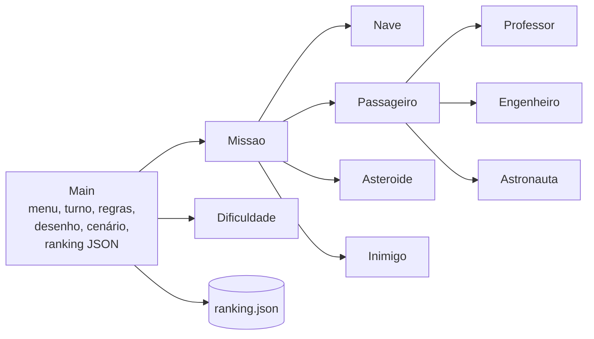
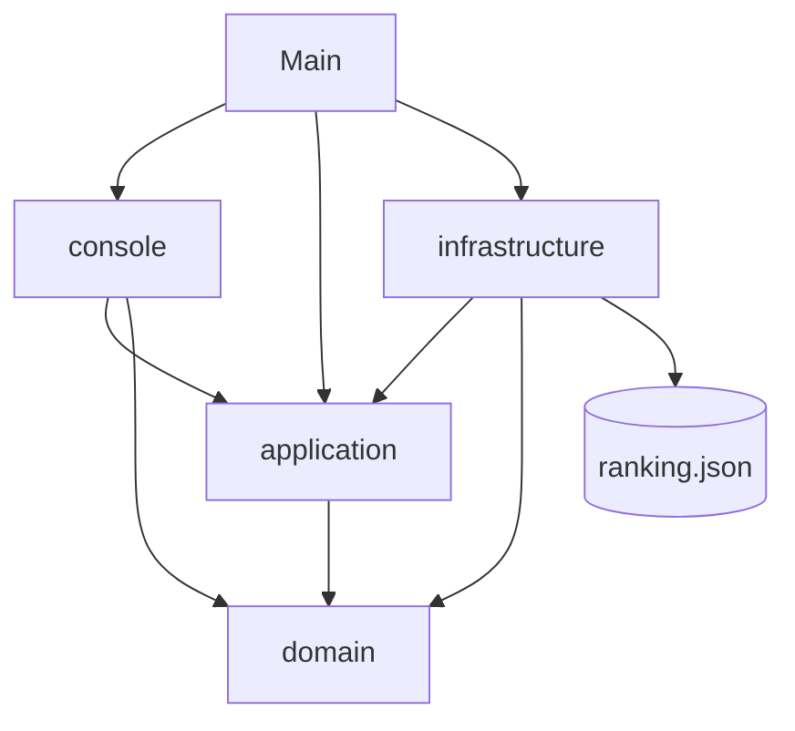
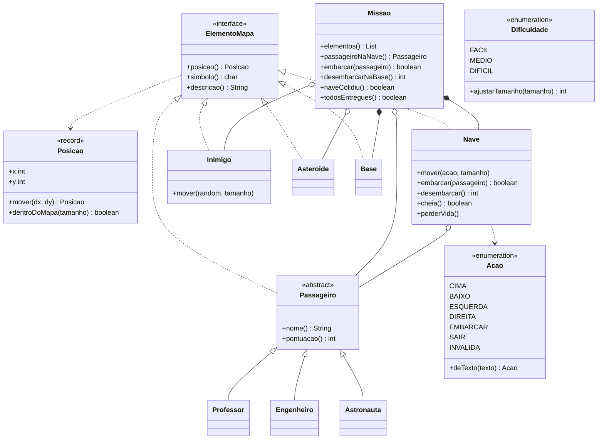

# Tutorial da fase 1: refatoração em camadas (MM-02)

O jogo de console da fase 0 foi reescrito em quatro camadas, mantendo as regras e os textos. A fase 0 continua intacta em `fases/fase-00-console`. O diagnóstico que guiou a refatoração está em `fases/fase-00-console/docs/diagnostico.md` (as referências `Main.java:linha` abaixo apontam para a fase 0).

Código: `src/br/edu/unifor/missaomarte/`, 23 classes.

| Pacote | Classes |
|---|---|
| `domain` | `Posicao`, `ElementoMapa`, `Passageiro`, `Professor`, `Engenheiro`, `Astronauta`, `Asteroide`, `Inimigo`, `Base`, `Nave`, `Missao`, `Dificuldade`, `Acao` |
| `application` | `MissaoFactory`, `GameSession`, `ResultadoTurno`, `RankingEntry`, `RankingRepository`, `RankingService` |
| `console` | `ConsoleGame`, `MapaRenderer` |
| `infrastructure` | `FileRankingRepository` |
| raiz | `Main` |

## 5.1 O que foi feito na migração

### Problemas do código original

| Problema | Trecho da fase 0 |
|---|---|
| Regras do turno misturadas com `System.out` | `jogarPartida`, `Main.java:81-210` |
| Leitura do teclado junto com o prompt | `lerLinha`, `Main.java:394-402` |
| Números da dificuldade espalhados em `switch` e `if` | `definirPontuacaoInicial` (`Main.java:244-250`) e `criarNovaMissao` (`Main.java:256-268`) |
| Símbolo decidido por `instanceof`, legenda fixa | `desenharMapa`, `Main.java:351-356` e `386` |
| Ranking em JSON dentro do `Main` | `loadRanking`, `saveRanking`, `parseRankingJson`, `Main.java:441-550` |
| Relógio e sorteio sem como controlar | `System.currentTimeMillis` (`Main.java:109`, `178`), `new Random()` (`Main.java:28`) |
| Laço infinito com mapa 1 no Médio e no Difícil | `criarNovaMissao`, `Main.java:271-299` |

### Passo a passo

1. Diagnóstico da fase 0 (MM-01): fluxo, acoplamentos e 30 comportamentos de referência.
2. `Posicao` (record) e `ElementoMapa` (posição, símbolo, descrição). Todo elemento do mapa passou a implementar `ElementoMapa`.
3. Passageiros: `Passageiro` virou abstrata; cada subclasse informa `pontuacao()`, `simbolo()` e `descricao()`. O campo de texto `tipo` saiu.
4. `Dificuldade` passou a guardar pontuação inicial, quantidades e tamanho mínimo do mapa.
5. `Acao` (enum) converte o texto digitado; `Nave.mover(Acao, tamanho)` usa o deslocamento da ação.
6. `Missao` guarda o tamanho do mapa e responde as perguntas do turno: colisão, embarque, desembarque na base, entregues.
7. `MissaoFactory` sorteia o cenário (mesma ordem e nomes do original) e recusa mapa abaixo do mínimo.
8. `GameSession` com as regras do turno, sem `Scanner` e sem `System.out`; recebe `Random` e `Clock`.
9. Ranking: `RankingEntry`, `RankingRepository`, `RankingService` (regra do top 5) e `FileRankingRepository` (mesmo `ranking.json`).
10. `ConsoleGame` (menu e textos) e `MapaRenderer` (mapa e legenda a partir dos elementos).
11. `Main` só monta as peças; `build.ps1` compila com `--release 17`.
12. Roteiro de testes (seção 5.7), com as entradas em `docs/` e as saídas em `docs/evidencias/`.

### Responsabilidade: onde estava e onde ficou

| Responsabilidade | Fase 0 | Fase 1 |
|---|---|---|
| Menu e leitura do teclado | `Main.main`, `Main.lerLinha` | `ConsoleGame.iniciar`, `ConsoleGame.lerLinha` |
| Converter o comando digitado | `Main.jogarPartida` (`charAt(0)`) | `Acao.deTexto` |
| Regras do turno (movimento, pontos, colisão, fim) | `Main.jogarPartida` | `GameSession.jogar` |
| Embarque | `Missao.embarcarPassageiroNaPosicao` | `Missao.passageiroNaNave` e `Missao.embarcar` |
| Desembarque na base | não existia | `Missao.desembarcarNaBase` |
| Movimento com limite do mapa | `Nave.moverComLimites` (4 inteiros) | `Nave.mover` com `Posicao.dentroDoMapa` |
| Números da dificuldade | `Main.definirPontuacaoInicial`, `Main.criarNovaMissao` | `Dificuldade` |
| Criar o cenário | `Main.criarNovaMissao` | `MissaoFactory.criar` |
| Símbolo e legenda | `Main.desenharMapa` (`instanceof`) | cada `ElementoMapa`; `MapaRenderer` |
| Regra do top 5 | `Main.java:187`, `Main.isTopScore` | `RankingService.registrar` |
| Ler e gravar `ranking.json` | `Main.loadRanking`, `saveRanking`, `parseRankingJson` | `FileRankingRepository` |
| Duração da partida | `System.currentTimeMillis` em `Main` | `GameSession.duracaoSegundos` com `Clock` |
| Montar tudo | `Main.main` | `Main.main` |

### Defeitos encontrados nos testes

| Defeito | O que fizemos |
|---|---|
| Mapa 1 no Médio ou no Difícil trava o jogo (o sorteio não acha célula livre). Na fase 0, `timeout 5` termina com 124 | Corrigido: `Dificuldade.ajustarTamanho` sobe para o mínimo e o console avisa; `MissaoFactory.criar` recusa mapa menor que o mínimo. Prova no passo extra da seção 5.7 |
| Nome de piloto com vírgula quebra a leitura do `ranking.json` (o leitor separa os campos por vírgula, `Main.java:510`) | Mantido como no original: a entrada com vírgula no nome é descartada na leitura. Está nas limitações |
| Depois que os inimigos andam, um inimigo pode ficar na célula da nave e some do desenho (só um símbolo por célula) | Mantido: a ordem de desenho é a do original. Visto na partida do diagnóstico |

### Mudanças de comportamento

Pedidas pelo enunciado da fase 1 (4.3) ou necessárias para ele:

1. **Desembarque.** A qualquer momento em que a nave está na base com passageiros a bordo, eles descem, contam como entregues e liberam a capacidade. Mensagem nova: `Passageiros entregues na base: N. Total entregues: E/T.` Na fase 0 parar na base no meio da partida não fazia nada.
2. **Vitória.** Acontece quando todos os passageiros foram entregues na base. Na fase 0 era "todos embarcados e nave em (0,0)"; o momento do fim é o mesmo, porque a ordem colisão → pontos → vitória continua.
3. **Indicadores.** A linha de status mostra a bordo, entregues, restantes e total, e a bordo + entregues + restantes = total em todo turno: `Nave em (x,y) | Pontos: P | Vidas: V | A bordo: B/C | Entregues: E | Restantes: R | Total: T`.
4. **Mapa mínimo.** Tamanho abaixo do mínimo da dificuldade vira o mínimo, com o aviso `Mapa pequeno demais para a dificuldade D. Usando tamanho M.` Mínimos: Fácil 1, Médio 2, Difícil 2. O Fácil com mapa 1 já funcionava e não muda.
5. **Passageiros no ranking e nas estatísticas.** `passageirosColetados` passa a ser o número de entregues. Na fase 0 era o tamanho da lista a bordo, que com o desembarque seria sempre 0.

Consequências pequenas da refatoração:

6. **Legenda montada pelos elementos do mapa.** O enunciado (4.2.6) pede a legenda a partir das entidades. Ela mostra só os tipos que estão no mapa, na ordem em que aparecem; o `.=Vazio` vem sempre no fim. Exemplo: no Fácil não existe Astronauta (os 4 passageiros são Professor e Engenheiro), então o `T=Astronauta` não aparece; quando todos embarcam, `P` e `E` somem.
7. **Alerta de "todos resgatados".** O alerta da fase 0 (`Main.java:206`) passa a valer quando não resta ninguém no mapa e ainda falta entregar.
8. **Fim da entrada depois de uma linha vazia.** A fase 0 abortava na hora; a fase 1 redesenha o mapa uma vez antes de mostrar `Entrada encerrada. Missão abortada.`
9. **Removido o que ninguém usava:** o identificador `"A-1"` da nave e os métodos `Nave.moveUp/moveDown/moveLeft/moveRight` (`Nave.java:27-30` da fase 0).

### Preservado de propósito

| Regra | Por quê |
|---|---|
| Bônus somado no embarque, uma vez só (não na entrega) | É a regra do original; mudar o momento mudaria a pontuação de todas as partidas |
| Top 5 | A referência do professor usa top 10 a partir da fase 2; mantemos o original, como o AVA pede |
| Capacidade 5 | O enunciado (4.3) aceita a regra explicada: 5 cabe todos os passageiros do Médio e do Difícil e 1 a mais que o Fácil, então a nave nunca precisa de mais de uma viagem por falta de espaço, mas pode fazer várias para fugir dos perigos |
| Colisão tira só vida; o ponto cai pelo movimento | O roteiro do enunciado (passo 5) fala em "perda de vida e de pontos". Lemos como a soma do turno: a colisão tira a vida e o movimento que levou ao perigo tira o ponto. Registrado como leitura ambígua |
| Sorteio por tentativa, mesma ordem e mesmos nomes | Com a mesma semente, o cenário sai na mesma ordem do original |

## 5.2 Onde foi usado SOLID

| Princípio | Classe(s) ou interface(s) | Como foi aplicado | Limite ou ponto que ainda viola |
|---|---|---|---|
| S: responsabilidade única | `GameSession`, `ConsoleGame`, `MapaRenderer`, `RankingService`, `FileRankingRepository` | Cada uma muda por um motivo: regra do turno (`GameSession.jogar`), tela de texto (`ConsoleGame`), desenho do mapa (`MapaRenderer.desenhar`), regra do top 5 (`RankingService.registrar`), formato do arquivo (`FileRankingRepository.salvar`) | `GameSession` também escreve as mensagens em português (`GameSession.embarcar`, `verificarColisao`): mudar um texto mexe na regra. `ConsoleGame` ainda faz menu, partida, estatísticas e tela de ranking |
| O: aberto/fechado | `Passageiro` e `ElementoMapa` | Um tipo novo de passageiro é uma subclasse com `pontuacao()`, `simbolo()` e `descricao()`; `GameSession`, `Missao`, `MapaRenderer` e a legenda não mudam | `MissaoFactory.criarPassageiro` tem um `switch` por índice que precisa ganhar o tipo novo. Uma dificuldade nova é uma constante a mais no enum `Dificuldade` (edição, não extensão) |
| L: substituição de Liskov | `Professor`, `Engenheiro`, `Astronauta`; `FileRankingRepository` | `GameSession.embarcar` usa qualquer `Passageiro` só por `nome()` e `pontuacao()`; `RankingService` funciona com qualquer `RankingRepository` | O contrato de falha do repositório (`UncheckedIOException`) só está no comentário de `RankingRepository`; outra implementação pode lançar outra exceção e o `ConsoleGame` não pegaria |
| I: segregação de interfaces | `ElementoMapa`, `RankingRepository` | `ElementoMapa` tem só os 3 métodos que o `MapaRenderer` usa; `RankingRepository` tem só carregar, salvar e limpar | `Missao` expõe para todos os métodos de montagem (`adicionar`, usados só pela fábrica) junto com os do turno |
| D: inversão de dependência | `RankingService` → `RankingRepository`; `GameSession` recebe `Random` e `Clock` | `RankingService` depende da interface, e o `Main` escolhe `FileRankingRepository`. `GameSession` e `RankingService` não criam relógio nem sorteio | `ConsoleGame` depende das classes concretas `GameSession`, `MissaoFactory` e `RankingService`; `GameSession` depende da classe concreta `Missao` |

## 5.3 Onde foi usado GRASP

| Padrão GRASP | Classe e método | Por que essa classe recebeu a responsabilidade |
|---|---|---|
| Controller | `GameSession.jogar(Acao)` | É quem recebe o evento do sistema "o jogador fez uma ação" fora da interface; o console só repassa |
| Information Expert | `Missao.naveColidiu`, `Missao.desembarcarNaBase`, `Missao.todosEntregues`; `Nave.cheia`; `Posicao.dentroDoMapa` | Cada uma tem os dados da pergunta: `Missao` tem as listas e o contador de entregues, `Nave` tem a capacidade e quem está a bordo, `Posicao` tem as coordenadas |
| Creator | `MissaoFactory.criar` cria `Missao`, `Nave`, passageiros e perigos; `Missao` cria a `Base` | A fábrica tem os dados para criar (`Dificuldade`, tamanho, `Random`); a `Missao` contém a base |
| Polymorphism | `Passageiro.pontuacao()`, `ElementoMapa.simbolo()` usado em `MapaRenderer.simboloEm` | A diferença entre os tipos fica em cada classe, sem `if` por tipo (o `grep` de `instanceof` não acha nada) |
| Pure Fabrication | `FileRankingRepository`, `MapaRenderer`, `MissaoFactory` | Não existem no jogo, foram inventadas para tirar persistência, desenho e montagem das classes do domínio |
| Indirection | `RankingRepository` | Fica entre `RankingService` e o arquivo, para o serviço não saber onde o ranking mora |
| Low Coupling | pacote `domain` | Não importa nada fora de `java.*` e do próprio pacote |
| Protected Variations | `RankingRepository`, `ElementoMapa` | Protegem o serviço de uma troca de armazenamento (a fase 5 terá servidor) e o desenho de um tipo novo de elemento |

## 5.4 Padrões de projeto

### Repository

- **Problema:** o `Main` da fase 0 sabia ler e gravar JSON (`Main.java:441-550`); trocar o arquivo por outro armazenamento obrigaria a mexer no jogo.
- **Participantes:** `RankingRepository` (interface), `FileRankingRepository` (arquivo), `RankingService` (quem usa).
- **Antes:** `List<RankingEntry> ranking = loadRanking(RANKING_PATH);` e `saveRanking(RANKING_PATH, rankingFiltrado);` dentro de `Main`.
- **Depois:** `RankingService.registrar` chama `repositorio.salvar(...)` sem saber que é arquivo; o `Main` faz `new RankingService(new FileRankingRepository(Path.of("ranking.json")), clock)`.
- **Segue o padrão?** Sim, na forma simples: uma coleção de `RankingEntry` acessada por interface.

### Simple Factory

- **Problema:** a montagem do cenário (quantidades, sorteio de posições, nomes) estava no `Main` (`Main.java:252-312`).
- **Participantes:** `MissaoFactory.criar(Dificuldade, int)`.
- **Depois:** `Missao missao = missaoFactory.criar(dificuldade, tamanho);` no `ConsoleGame`.
- **Segue o padrão?** É uma fábrica simples: uma classe com um método que monta objetos. Não é o Factory Method nem o Abstract Factory do GoF (não há hierarquia de fábricas).

### Injeção de dependência pelo construtor

- **Problema:** classes que criam o próprio `Random`, relógio ou arquivo não podem ser testadas nem trocadas.
- **Participantes:** `Main` (monta), `ConsoleGame`, `GameSession`, `RankingService`, `MissaoFactory` (recebem).
- **Depois:** `new GameSession(piloto, dificuldade, missao, random, clock)`; a semente vem de `-Dmissaomarte.semente=N`.
- **Segue o padrão?** Sim, feito à mão (sem framework). O `Main` é a raiz de composição.

### Value Object

- **Participantes:** `Posicao` (record).
- **Segue o padrão?** Sim: imutável (`mover` devolve outra `Posicao`) e igual por valor (`equals` e `hashCode` do record comparam `x` e `y`).

### O que não é padrão

`Dificuldade` é uma tabela de números dentro do enum, não uma Strategy: as três dificuldades se comportam igual e só mudam os valores.

## 5.5 Diagramas

### Antes (fase 0)



### Dependências entre camadas (depois)



Nenhuma seta sai de `domain` nem de `application` para `console` ou `infrastructure` (provado pelo `grep` da seção 5.7).

### Classes do domínio



## 5.6 Limitações conhecidas

| Limitação | Onde | Como resolver |
|---|---|---|
| A sessão escreve as mensagens em português | `GameSession.embarcar`, `verificarColisao`, `verificarFim` | A fase 4 acrescenta eventos ao `ResultadoTurno` (sem mudar a assinatura) e cada interface escolhe o próprio texto |
| O console depende de classes concretas e faz muita coisa | `ConsoleGame` (menu, partida, estatísticas, ranking) | Separar a tela de ranking e a de estatísticas; depender de interfaces (desafio opcional 4 do enunciado) |
| Tipo novo de passageiro mexe na fábrica | `MissaoFactory.criarPassageiro` (`switch` por índice) | Uma lista de criadores (`List<BiFunction<String, Posicao, Passageiro>>`) percorrida pelo índice |
| Leitor de JSON feito à mão | `FileRankingRepository.interpretarObjeto` separa por vírgula: nome com vírgula quebra a leitura | Com o Gradle (fase 2) dá para usar uma biblioteca de JSON, ou escapar a vírgula na gravação |
| Sorteio por tentativa | `MissaoFactory.posicaoLivre` (`do/while`) | Com o mapa quase cheio fica lento; listar as células livres e embaralhar resolve |
| Montagem e jogo na mesma interface da `Missao` | `Missao.adicionar` é público para todos | Passar as listas prontas pelo construtor da `Missao` |
| A regra de "novo recorde" ficou no console | `ConsoleGame.exibirVitoria` compara os pontos com o primeiro do ranking | Levar a comparação para o `RankingService`, que já tem a regra do top 5 |
## 5.7 Como executar e testar

### Compilar e rodar

PowerShell, na pasta `fases/fase-01-refatoracao`:

```powershell
.\build.ps1          # compila em out/
.\build.ps1 -Run     # compila e joga
```

Git Bash, com a entrada vinda de arquivo e cenário fixo:

```bash
java -Dstdout.encoding=UTF-8 -Dmissaomarte.semente=4 -cp out br.edu.unifor.missaomarte.Main < docs/entrada-vitoria.txt
```

- `-Dmissaomarte.semente=N` fixa o sorteio (sem ele cada partida é diferente).
- `-Dstdout.encoding=UTF-8` mantém os acentos quando a saída vai para arquivo.
- A entrada vem de arquivo (`<`): pelo pipe do PowerShell 5.1 a entrada não chega ou chega com o acento corrompido.

### Provas de build e de camadas (21/11/2026, JDK 25 compilando com `--release 17`)

```text
PS> .\build.ps1
Compilado em out/ (23 arquivos).
(código de saída 0)

$ javap -v -cp out br.edu.unifor.missaomarte.Main | grep major
  major version: 61                      (61 = Java 17)

$ grep -rE "import br\.edu\.unifor\.missaomarte\.(console|infrastructure)" src/br/edu/unifor/missaomarte/domain src/br/edu/unifor/missaomarte/application
(sem resultado)
$ grep -rnE "System\.out|Scanner|currentTimeMillis" src/br/edu/unifor/missaomarte/domain src/br/edu/unifor/missaomarte/application
(sem resultado)
$ grep -rnE "instanceof|getClass\(\)" src
(sem resultado)
```

### Roteiro de 8 passos

Todos com semente 4, no Git Bash, a partir de um estado sem `ranking.json`, na ordem abaixo (o passo 7 usa o ranking gravado no passo 6). Comando de cada passo:

```bash
java -Dstdout.encoding=UTF-8 -Dmissaomarte.semente=4 -cp out br.edu.unifor.missaomarte.Main < docs/entrada-<nome>.txt > docs/evidencias/saida-<nome>.txt
```

A saída completa de cada passo está em `docs/evidencias/`. Abaixo, o resumo (sem os mapas). Com a semente 4 e mapa 2 no Fácil, o cenário é: passageiros em (1,1) P, (0,-2) E, (-1,-1) P, (0,1) E; asteroide em (2,-1); inimigo em (-2,2).

**1. Menu: opções válidas e uma inválida** (`entrada-menu.txt`: `9`, `2`, `3`, `n`, `4`). Resultado: ok.

```text
Escolha uma opção: Opção inválida. Tente novamente.
====== RANKING TOP 5 PILOTOS ======
 - Nenhum registro encontrado. Seja o primeiro a jogar!
Você realmente deseja limpar o histórico de ranking? (s/n): Operação cancelada.
Obrigado por jogar a Missão Marte Unifor!
```

**2. Partida no Fácil, no Médio e no Difícil, com os indicadores fechando** (`entrada-dificuldades.txt`, mapa 3, `q` logo no início de cada uma). Resultado: ok, 0 + 0 + 4 = 4 e 0 + 0 + 5 = 5. Nos passos 3, 4 e 5 a soma também fecha em todo turno.

```text
Iniciando missão na dificuldade Fácil...
Nave em (0,0) | Pontos: 30 | Vidas: 3 | A bordo: 0/5 | Entregues: 0 | Restantes: 4 | Total: 4
Iniciando missão na dificuldade Médio...
Nave em (0,0) | Pontos: 20 | Vidas: 3 | A bordo: 0/5 | Entregues: 0 | Restantes: 5 | Total: 5
Iniciando missão na dificuldade Difícil...
Nave em (0,0) | Pontos: 45 | Vidas: 3 | A bordo: 0/5 | Entregues: 0 | Restantes: 5 | Total: 5
```

**3. Embarcar numa célula sem passageiro e numa com passageiro** (`entrada-embarque.txt`: `c` na base, `s`, `c`, `q`). Resultado: ok; o `c` sem passageiro gasta o turno e não muda os pontos.

```text
Nave em (0,0) | Pontos: 30 | Vidas: 3 | A bordo: 0/5 | Entregues: 0 | Restantes: 4 | Total: 4
Comando (w/s/a/d/c/q): Nenhum passageiro nesta posição.
Nave em (0,1) | Pontos: 29 | Vidas: 3 | A bordo: 0/5 | Entregues: 0 | Restantes: 4 | Total: 4
Comando (w/s/a/d/c/q): Passageiro Eng. Carlos embarcado com sucesso! +15 pontos!
Nave em (0,1) | Pontos: 44 | Vidas: 3 | A bordo: 1/5 | Entregues: 0 | Restantes: 3 | Total: 4
```

**4. Levar passageiros à base: desembarque e vitória** (`entrada-vitoria.txt`: embarca 2, volta à base, embarca mais 2, volta). Resultado: ok; dois desembarques, a capacidade volta a 0/5 e a vitória sai no segundo.

```text
Nave em (1,0) | Pontos: 52 | Vidas: 3 | A bordo: 2/5 | Entregues: 0 | Restantes: 2 | Total: 4
Comando (w/s/a/d/c/q): Passageiros entregues na base: 2. Total entregues: 2/4.
Nave em (0,0) | Pontos: 51 | Vidas: 3 | A bordo: 0/5 | Entregues: 2 | Restantes: 2 | Total: 4
(...)
Comando (w/s/a/d/c/q): Passageiro Dr. Lima embarcado com sucesso! +10 pontos!
✨ ALERTA: Todos os passageiros resgatados! Retorne para a Plataforma de Pouso 'L' em (0,0) para completar a missão.
Nave em (0,-1) | Pontos: 71 | Vidas: 3 | A bordo: 2/5 | Entregues: 2 | Restantes: 0 | Total: 4
Comando (w/s/a/d/c/q): Passageiros entregues na base: 2. Total entregues: 4/4.

================================================================
🚀 DECOLAGEM AUTORIZADA! Nave acoplada à plataforma em (0,0).
Retornando à órbita marciana com todos os passageiros. Missão cumprida!
================================================================
Estatísticas da Partida:
 - Pontuação Final: 70 pontos
 - Movimentos Efetuados: 10
 - Tempo de Jogo: 0 segundos
 - Passageiros Resgatados: 4
================================================================
Parabéns! Você entrou para o Top 5 de pilotos!
```

**5. Colidir com um perigo: perda de vida e de pontos** (`entrada-colisao.txt`: `d`, `d`, `w` até o asteroide em (2,-1), `c` parado nele, `q`). Resultado: ok; o movimento tira o ponto, a colisão tira a vida, e ficar parado no perigo tira outra vida.

```text
Nave em (2,0) | Pontos: 28 | Vidas: 3 | A bordo: 0/5 | Entregues: 0 | Restantes: 4 | Total: 4
Comando (w/s/a/d/c/q): Alerta! Colisão detectada! Vidas restantes: 2
Nave em (2,-1) | Pontos: 27 | Vidas: 2 | A bordo: 0/5 | Entregues: 0 | Restantes: 4 | Total: 4
Comando (w/s/a/d/c/q): Nenhum passageiro nesta posição.
Alerta! Colisão detectada! Vidas restantes: 1
Nave em (2,-1) | Pontos: 27 | Vidas: 1 | A bordo: 0/5 | Entregues: 0 | Restantes: 4 | Total: 4
```

**6. Vitória gravando no ranking e consulta** (a mesma `entrada-vitoria.txt` termina com `2` no menu). Resultado: ok.

```text
====== RANKING TOP 5 PILOTOS ======
1. Ana - 70 pts | Dificuldade: Fácil | Coletados: 4 | Tempo: 0s | 2026-11-21 12:31:42
===================================

$ cat ranking.json        (docs/evidencias/ranking-depois-da-vitoria.txt)
[{"name":"Ana","score":70,"dificuldade":"FACIL","passageirosColetados":4,"dataHora":"2026-11-21 12:31:42","tempoJogo":0}]
```

**7. Limpar o ranking** (`entrada-limpar.txt`: `2`, `3`, `s`, `2`, `4`). Resultado: ok; depois do passo, `ranking.json` não existe mais.

```text
====== RANKING TOP 5 PILOTOS ======
1. Ana - 70 pts | Dificuldade: Fácil | Coletados: 4 | Tempo: 0s | 2026-11-21 12:31:42
Você realmente deseja limpar o histórico de ranking? (s/n): Ranking resetado com sucesso!
====== RANKING TOP 5 PILOTOS ======
 - Nenhum registro encontrado. Seja o primeiro a jogar!
```

**8. Encerrar com `Q` e encerrar a entrada no meio da partida** (`entrada-sair.txt` termina com `Q` maiúsculo; `entrada-fim-da-entrada.txt` acaba depois de um `d`). Resultado: ok nos dois.

```text
(entrada-sair.txt)
Nave em (1,0) | Pontos: 29 | Vidas: 3 | A bordo: 0/5 | Entregues: 0 | Restantes: 4 | Total: 4
Comando (w/s/a/d/c/q): Missão abortada pelo piloto.

(entrada-fim-da-entrada.txt)
Nave em (1,0) | Pontos: 29 | Vidas: 3 | A bordo: 0/5 | Entregues: 0 | Restantes: 4 | Total: 4
Comando (w/s/a/d/c/q): Entrada encerrada. Missão abortada.
Entrada encerrada. Obrigado por jogar!
```

### Passo extra: o mapa 1 não trava mais

A mesma entrada que trava a fase 0 (`entrada-mapa1-medio.txt`: Médio, mapa 1):

```text
(fase 0)
$ timeout 5 java -Dstdout.encoding=UTF-8 -cp out Main < docs/entrada-mapa1-medio.txt; echo $?
124

(fase 1)
$ timeout 5 java -Dstdout.encoding=UTF-8 -Dmissaomarte.semente=4 -cp out br.edu.unifor.missaomarte.Main < docs/entrada-mapa1-medio.txt; echo $?
Tamanho do mapa (ex: 5 para mapa de -5 a +5): Mapa pequeno demais para a dificuldade Médio. Usando tamanho 2.
Iniciando missão na dificuldade Médio...
Nave em (0,0) | Pontos: 20 | Vidas: 3 | A bordo: 0/5 | Entregues: 0 | Restantes: 5 | Total: 5
Comando (w/s/a/d/c/q): Missão abortada pelo piloto.
0
```
