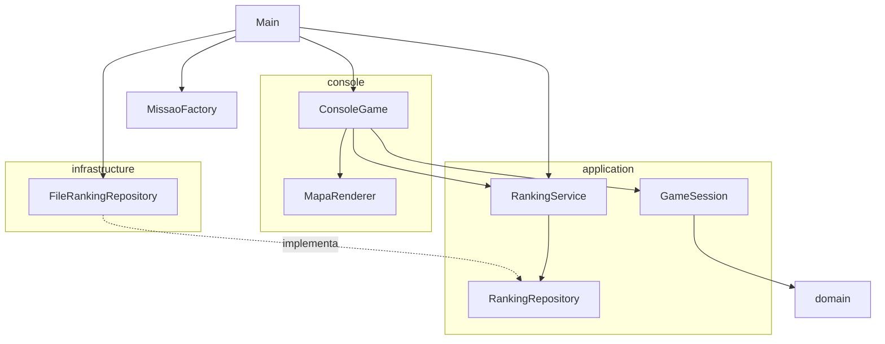
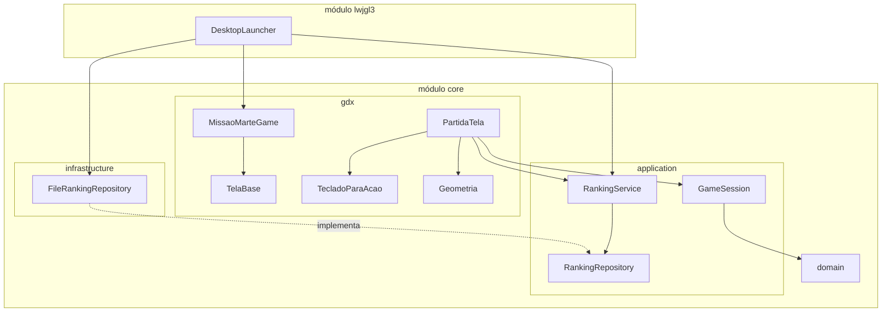

# Tutorial da fase 3: o jogo no libGDX (MM-04 e MM-05)

O jogo da fase 2 agora abre numa janela de 800 x 600 feita com libGDX 1.12.1. As regras não mudaram: `domain`, `application` e `infrastructure` são cópias idênticas da fase 2 (seção 8.5). O que é novo é o pacote `gdx` (o jogo, as telas, a conversão de teclas e de coordenadas) e o módulo `lwjgl3` (o launcher desktop).

## 8.1 Estado de origem e destino

**Antes (fase 2):** um projeto Gradle de módulo único, com o plugin `application` e o `Main` lendo o teclado pelo `Scanner` do console. O `ConsoleGame` mostrava o menu, lia os comandos e imprimia o mapa com o `MapaRenderer`.

**Agora (fase 3):** dois módulos.

```text
fase-03-libgdx/
├── settings.gradle            rootProject 'missao-marte', include 'core', 'lwjgl3'
├── build.gradle               gdxVersion = '1.12.1' num lugar só; Java 17, UTF-8 e mavenCentral() nos módulos
├── core/build.gradle          java-library; api gdx; JUnit 5 com junit-platform-launcher
├── core/src/main/java/br/edu/unifor/missaomarte/
│   ├── domain/                cópia idêntica da fase 2 (13 arquivos)
│   ├── application/           cópia idêntica da fase 2 (6 arquivos)
│   ├── infrastructure/        cópia idêntica da fase 2 (1 arquivo)
│   └── gdx/                   MissaoMarteGame, TelaBase, MenuTela, NovaPartidaTela, PartidaTela,
│                              RankingTela, TecladoParaAcao, Geometria
├── core/src/test/java/...     os 24 testes herdados, sem alteração, e 14 novos
├── lwjgl3/build.gradle        application; core, gdx-backend-lwjgl3, gdx-platform natives-desktop
└── lwjgl3/src/main/java/br/edu/unifor/missaomarte/lwjgl3/DesktopLauncher.java
```

| Fase 2 | Fase 3 |
|---|---|
| `Main` (lê a semente, monta as peças, chama `ConsoleGame.iniciar()`) | `DesktopLauncher` (lê a semente, monta as mesmas peças, abre a `Lwjgl3Application`) |
| `ConsoleGame` (laço do menu e da partida) | `MenuTela`, `NovaPartidaTela`, `PartidaTela`, `RankingTela`, trocadas pelo `MissaoMarteGame` |
| `MapaRenderer` (mapa em texto) | `PartidaTela.desenharFormas()` e `desenharTextos()` com `ShapeRenderer` e `BitmapFont` |
| `Acao.deTexto(linha)` (texto digitado, embarque no `c`) | `TecladoParaAcao.converter(tecla)` (código da tecla, embarque no `E`) |
| linha e coluna do texto | `Geometria` (célula para pixel, com o Y invertido) |
| `gradlew run` | `gradlew :lwjgl3:run` |
| um `build.gradle` | `build.gradle` raiz + `core/build.gradle` + `lwjgl3/build.gradle` |

Antes:



Depois:



A regra de dependência: as setas só apontam para dentro. `gdx` conhece `application` e `domain`; `application` conhece só `domain`; ninguém fora de `gdx` e `lwjgl3` importa `com.badlogic` (seção 8.5). Quem liga a implementação em arquivo à interface é o launcher.

## 8.2 Conceitos de libGDX aplicados

**O que é o libGDX e por que dois módulos.** O libGDX é um framework de jogos em Java. O jogo é escrito contra interfaces (`Gdx.graphics`, `Gdx.input`, `Gdx.app`) e cada plataforma tem um *backend* que implementa essas interfaces: o LWJGL3 no desktop, outro no Android. Por isso o jogo mora no `core`, que só depende de `com.badlogicgames.gdx:gdx`, e o `lwjgl3` só tem o launcher e as dependências do backend (`gdx-backend-lwjgl3` e as nativas `gdx-platform:natives-desktop`). Na fase 6, o Android ganha outro módulo ao lado do `lwjgl3`, com o mesmo `core`.

**Ciclo de vida.** A aplicação chama `create()` uma vez, `render()` a cada quadro, `resize()` quando a janela muda de tamanho, `pause()` e `resume()` quando ela perde ou ganha a vez (minimizar, por exemplo) e `dispose()` ao fechar. O `Game` repassa essas chamadas para a tela atual (`Screen`), que tem ainda `show()` (ao entrar) e `hide()` (ao sair). Na nossa `TelaBase` toda passagem vira uma linha de log, num lugar só:

```java
private void log(String evento) {
    Gdx.app.log(TAG, getClass().getSimpleName() + "." + evento);
}
```

Saída real da primeira execução (`docs/evidencias/saida-run-minimizar.txt`), com a janela minimizada e restaurada no meio:

```text
[MissaoMarte] create()
[Tela] MenuTela.show()
[Tela] MenuTela.resize(800, 600)
[Tela] MenuTela.resize(800, 600)
[Tela] MenuTela.hide()
[Tela] NovaPartidaTela.show()
[Tela] NovaPartidaTela.resize(800, 600)
[Tela] MenuTela.dispose()
[Tela] NovaPartidaTela.resize(0, 0)
[Tela] NovaPartidaTela.pause()
[Tela] NovaPartidaTela.resize(800, 600)
[Tela] NovaPartidaTela.resume()
...
[Tela] MenuTela.pause()
[MissaoMarte] dispose()
[Tela] MenuTela.hide()
[Tela] MenuTela.dispose()
```

- O `resize(800, 600)` aparece duas vezes logo no início: o `setScreen` chama `resize` ao instalar o menu, dentro do `create()`, e o backend chama de novo quando a janela aparece pela primeira vez.
- Minimizar gera `resize(0, 0)` e `pause()`; restaurar gera `resize(800, 600)` e `resume()`.
- Ao fechar, o `pause()` vem antes do `dispose()`: o backend LWJGL3 pausa a aplicação e só depois a libera.

**`Game` e `Screen`, e o padrão State.** O `Game` é um `ApplicationListener` que guarda uma tela atual e repassa o ciclo de vida para ela. Cada tela é um estado (menu, nova partida, partida, ranking), com o próprio desenho e as próprias teclas, e `setScreen` troca o estado. É o padrão State: o `MissaoMarteGame` é o contexto e não tem `if` sobre qual tela está ativa; quem decide a próxima tela é a tela atual (`MenuTela` chama `jogo.trocarTela(new NovaPartidaTela(jogo))`).

**Câmera e viewport.** A `OrthographicCamera` define o mundo de 800 x 600 unidades que as telas usam para desenhar. O `FitViewport(800, 600, camera)` decide como esse mundo cabe na janela: ele aumenta ou diminui mantendo a proporção 4:3 e deixa faixas nas sobras. Toda tela faz o mesmo no `render`, também na `TelaBase`:

```java
jogo.viewport().apply();
jogo.batch().setProjectionMatrix(jogo.camera().combined);
jogo.formas().setProjectionMatrix(jogo.camera().combined);
```

e o `resize` chama `viewport.update(largura, altura, true)`. A captura `docs/capturas/f3-redimensionada.png` foi tirada com a janela em 1200 x 900 (o log `docs/evidencias/saida-run-redimensionar.txt` mostra `PartidaTela.resize(1200, 900)`): o mapa e o painel aumentaram 1,5 vez, com a mesma proporção.

**Por turnos, mas desenhando a cada quadro.** O `render()` roda 60 vezes por segundo, mas só lê o estado: desenha o mapa a partir de `missao.elementos()` e o painel a partir da `GameSession`. O estado só muda no `keyDown` da `PartidaTela`, que chama `sessao.jogar(acao)` uma vez por tecla. Assim o jogo continua igual ao console: uma tecla válida, um turno. Desenhar a cada quadro é o que permite redimensionar e minimizar sem perder a imagem.

**Recursos e `dispose()`.** `SpriteBatch`, `ShapeRenderer` e `BitmapFont` guardam memória da placa de vídeo, que o coletor de lixo do Java não libera. Eles são criados uma vez no `MissaoMarteGame.create()` e liberados no `MissaoMarteGame.dispose()`. As telas não criam nenhum recurso pesado: pedem ao jogo (`jogo.batch()`, `jogo.fonte()`). O `Game` do libGDX não chama o `dispose()` das telas; o nosso `trocarTela` chama, depois do `setScreen`, só para o log mostrar o ciclo completo de cada tela (o `dispose()` da tela não libera nada).

## 8.3 Decisões de projeto

**Ranking: `RankingRepository` e `RankingEntry` já estavam em `application`.** O enunciado parte de uma fase 2 em que o ranking estava no console e a interface em `infrastructure`, e manda mover para `application`. Na nossa fase 1 isso já tinha sido feito: `RankingRepository`, `RankingEntry` e `RankingService` (listar, registrar devolvendo se entrou, limpar) moram em `application`, e só o `FileRankingRepository` está em `infrastructure`. Por isso não houve mudança de pacote nesta fase, e os arquivos continuam idênticos aos da fase 2 (o enunciado dá `application.ranking` só como exemplo). A tela gráfica usa o mesmo `RankingService` que o console usava, sem copiar regra.

**Top 5, não Top 10.** O enunciado fala em Top 10 (5.4) e em 28 testes herdados. O jogo que a equipe recebeu na fase 0 guarda o Top 5, o AVA da disciplina manda preservar as regras e o próprio enunciado diz "preserve as regras atuais". Mudar para 10 seria mudar uma regra para seguir o texto de outra versão do jogo, então ficou 5, e o `RankingServiceTest` cobre o limite de 5. Pela mesma razão, os herdados são os nossos 24 testes da fase 2, não 28.

**`ElementoMapa.simbolo()` no papel do `ObjetoRenderizavel#getSimbolo()`.** O enunciado fala numa interface `ObjetoRenderizavel`. No nosso domínio, desde a fase 1, quem faz esse papel é a interface `ElementoMapa`, com `char simbolo()`: nave, base, passageiros, asteroides e inimigos a implementam. Criar outra interface só para mudar o nome mexeria no `domain`, que tem que ficar idêntico; a `PartidaTela` usa `simbolo()` para escolher a cor e a letra, sem `instanceof`.

**Por que a conversão de coordenadas é uma classe separada (`Geometria`).** No jogo, `CIMA` é `y - 1` (o Y cresce para baixo, como as linhas impressas no console); no libGDX o Y cresce para cima. Se cada tela fizesse a conta, o erro de inverter o eixo apareceria em vários lugares. A `Geometria` faz a conta num lugar só, não importa nada do libGDX e por isso é testada sem janela (`GeometriaTest`). Ela também fixa o layout: células de 48 px a partir de (16, 36), mapa de 528 x 528, e aceita `float` para a fase 4 poder desenhar posições fracionárias.

**Por que `TecladoParaAcao` é separada das telas.** A tela só precisa de uma `Acao`; quem sabe que `W` e a seta para cima são `CIMA` é o conversor. Separado, ele é testado sem janela (as constantes de `Input.Keys` são só números) e pode ser trocado (por exemplo, I/J/K/L) sem mexer na `PartidaTela` nem na `GameSession`. Ele mapeia direto para o enum, sem passar pelo `Acao.deTexto` do console, porque lá o embarque é a letra `c` e aqui é `E`.

**Padrões usados.**

| Padrão | Onde | Segue de fato ou só parece? |
|---|---|---|
| State | `MissaoMarteGame` + telas (`setScreen`) | Segue: cada tela é um estado com o próprio comportamento, e a transição é feita pela tela atual. |
| Template Method | `TelaBase.render()` aplica viewport e projeção e chama `desenhar(delta)`; `show()`/`hide()` instalam e tiram o teclado e chamam os ganchos `teclaApertada`/`caractereDigitado` | Segue: o esqueleto é fixo na classe base e as subclasses preenchem os passos. |
| Injeção de dependência | `MissaoMarteGame` recebe `MissaoFactory`, `RankingService`, `Random` e `Clock` pelo construtor; o `DesktopLauncher` é o *composition root* | Segue (injeção manual, sem framework). |
| Adapter | `TecladoParaAcao` converte código de tecla do libGDX em `Acao` do domínio | Parece mais do que segue: é uma função de conversão, não um objeto que implementa uma interface esperada por outro. |
| Pure Fabrication | `Geometria` | Segue: não representa nada do domínio, existe para isolar uma responsabilidade técnica e deixar o resto coeso. |
| Observer | `InputProcessor` instalado com `Gdx.input.setInputProcessor` | Só parece: há um único ouvinte por vez, trocado a cada tela. |

## 8.4 Passo a passo

Os comandos rodaram no Git Bash, na pasta da fase, com:

```bash
export JAVA_HOME="/c/Users/Arthur Pinheiro/.jdks/jdk-17.0.21.1+2"
export JAVA_TOOL_OPTIONS='-Djdk.net.unixdomain.tmpdir=C:/Users/ARTHUR~1/.gradle/udtmp'
```

(o segundo só porque, nesta máquina, o Gradle não consegue criar o socket local na pasta temporária padrão).

1. **Branch e estrutura.** `git checkout -b mm-04-libgdx` a partir da `mm-03-gradle`. Criei `core/` e `lwjgl3/`, copiei o wrapper 8.7, o `gradlew`, o `gradlew.bat` e o `.gitattributes` da fase 2, e copiei `domain`, `application` e `infrastructure` para `core/src/main/java` e os testes para `core/src/test/java` com `cp -r`, sem abrir para editar.
2. **Build multi-módulo.** `settings.gradle` com `include 'core', 'lwjgl3'`; `build.gradle` raiz com `ext { gdxVersion = '1.12.1' }` e um bloco `subprojects` com Java 17, UTF-8 e `mavenCentral()`; `lwjgl3/build.gradle` com o plugin `application`, `workingDir = rootProject.projectDir` no `run` e o `-XstartOnFirstThread` só quando `os.name` tem "mac".
3. **Problema real: `api` não existe.** O primeiro `./gradlew clean build` falhou com `Could not find method api() for arguments [com.badlogicgames.gdx:gdx:1.12.1]`. O `api` só existe com o plugin `java-library` (o `java` comum só tem `implementation`). Resolvi com `apply plugin: 'java-library'` no `core/build.gradle`. O `api` faz o `lwjgl3`, que depende do `core`, enxergar o `gdx` também.
4. **Telas e conversores.** Escrevi `Geometria` e `TecladoParaAcao` com os testes, depois `MissaoMarteGame`, `TelaBase` e as quatro telas. O segundo build saiu com `BUILD SUCCESSFUL` e 38 testes.
5. **Semente.** O `-Dmissaomarte.semente=4` passado ao `gradlew` fica no processo do Gradle, não no do jogo. O `lwjgl3/build.gradle` repassa com `systemProperty 'missaomarte.semente', System.getProperty('missaomarte.semente', '')`. Quando ninguém passa a semente, chega uma string vazia; o `DesktopLauncher` testa `isBlank()` (e não só `null`), porque `Long.parseLong("")` derrubaria o jogo.
6. **Problema real: como testar a janela sem digitar nas outras.** Para tirar as capturas, a primeira tentativa usou `SendKeys` e captura da área da tela. A captura saiu com outra janela por cima (o jogo não estava na frente) e o `SendKeys` digitaria em qualquer janela que estivesse ativa. Troquei por um script PowerShell que manda as teclas por `PostMessage` direto para a janela "Missão Marte" (com o código de varredura certo, que o GLFW usa para saber a tecla) e captura com `PrintWindow`. Nessa primeira execução, uma tecla `1` chegou à janela quando ela abriu, sem vir do script (o log mostra o menu indo para a nova partida); as execuções seguintes, só com o `PostMessage`, não tiveram tecla fora do roteiro.
7. **Problema real: letras sobrepostas na base.** Na primeira partida a nave começou em cima da base e a célula mostrava o `@` e o `L` desenhados um sobre o outro. Os retângulos já saíam na ordem certa (base primeiro, nave por cima), mas o texto também era desenhado para todos. Passei a escrever só a letra do elemento de cima de cada célula (`PartidaTela.coberto`).
8. **Problema achado na revisão: teclas atrasadas.** No backend LWJGL3 as teclas de um mesmo quadro são entregues todas ao processador que estava ativo no começo do quadro, mesmo que a tela tenha trocado no meio. Dois `Enter` no mesmo quadro na tela de fim abririam duas telas de ranking. A `PartidaTela` passou a guardar `saiu` e a ignorar teclas depois de trocar de tela. (Hipótese pelo funcionamento da fila de eventos; não reproduzi com dois `Enter`.)
9. **Problema real: log sem acento.** O `System.out` do Java nesta máquina sai em cp1252. A primeira versão das evidências passou por um `grep` que tratou o arquivo como binário e perdeu as linhas com acento (por exemplo, `vitória registrada`). Regravei as evidências convertendo com `iconv -f cp1252 -t utf-8`.
10. **Tecla que consome turno.** Conferido no log: um `X` enviado no começo da partida não gerou linha de turno nem mudou os pontos; o `W` seguinte gerou `CIMA -> pontos 29`.
11. **Partida completa com semente 4** (seção 8.5): duas entregas, uma colisão de propósito, vitória registrada uma vez; depois uma partida no difícil perdida por colisões.

## 8.5 Testes e evidências

**Testes (38, nenhum abre janela nem usa OpenGL).**

| Classe | Testes | O que cobre |
|---|---|---|
| `GameSessionTest` (herdado) | 6 | embarque, embarque sem passageiro, entrega, colisão, vitória, sair e comando inválido |
| `MissaoFactoryTest` (herdado) | 5 | quantidades por dificuldade, posições livres e mapa pequeno demais |
| `AcaoTest`, `NaveTest`, `PosicaoTest` (herdados) | 3 + 4 + 3 | conversão do console, nave, posição |
| `FileRankingRepositoryTest` (herdado) | 3 | gravar e ler, arquivo ausente, limpar |
| `TecladoParaAcaoTest` | 4 | letras, setas, `E` embarca, `Q`/`Esc` saem, tecla sem ação (inclusive o `c` do console) é `INVALIDA` |
| `GeometriaTest` | 4 | lado do mapa, X crescente, Y invertido (`y = -5` no topo), centro da célula |
| `RankingServiceTest` | 6 | zero e negativo não entram, ordem decrescente, limite de 5, lista cheia só entra maior que o pior (empate não entra), limpar, dados gravados com a data do relógio |

O `RankingServiceTest` usa um repositório em memória escrito dentro do próprio teste. Os 24 herdados estão sem alteração: `diff -r ../fase-02-gradle/src/test/java core/src/test/java` só lista arquivos novos.

**`./gradlew clean build`** (saída inteira em `docs/evidencias/saida-clean-build.txt`):

```text
Gradle 8.7
JVM:          17.0.21.1 (Eclipse Adoptium 17.0.21.1+2)
> Task :core:compileJava
> Task :core:test
> Task :core:build
> Task :lwjgl3:compileJava
> Task :lwjgl3:startScripts
> Task :lwjgl3:build

BUILD SUCCESSFUL in 3s
11 actionable tasks: 11 executed
```

Soma dos relatórios: `cat core/build/test-results/test/*.xml | grep -o 'tests="[0-9]*" skipped="[0-9]*" failures="[0-9]*" errors="[0-9]*"' | awk -F'"' '{t+=$2;f+=$6;e+=$8} END {print t, f, e}'` imprime `38 0 0`.

**Hash dos fontes copiados.** `docs/evidencias/hash-fase-02-x-fase-03.txt` tem o `sha256sum` dos 20 arquivos de `domain`, `application` e `infrastructure` da fase 2 e o `sha256sum -c` na fase 3: os 20 dão `OK`. `diff -r` das três pastas também sai vazio. Nenhum arquivo dessas camadas é novo ou diferente.

**Camadas.** `grep -rln "com.badlogic" core/src/main/java/br/edu/unifor/missaomarte/{domain,application,infrastructure}` não imprime nada; `grep -rn "System.getProperty" core/src` também não (a semente é lida só no launcher).

**Execução com semente 4** (`./gradlew :lwjgl3:run --console=plain -Dmissaomarte.semente=4`, log inteiro em `docs/evidencias/saida-run-semente-4.txt`). Trecho da partida no fácil:

```text
[Partida] ESQUERDA -> pontos 25, vidas 3, a bordo 0, entregues 0/4
[Partida] CIMA -> pontos 24, vidas 3, a bordo 0, entregues 0/4
[Partida] EMBARCAR -> pontos 34, vidas 3, a bordo 1, entregues 0/4
...
[Partida] DIREITA -> pontos 28, vidas 3, a bordo 0, entregues 1/4
...
[Partida] EMBARCAR -> pontos 44, vidas 3, a bordo 2, entregues 1/4
[Partida] ESQUERDA -> pontos 43, vidas 2, a bordo 2, entregues 1/4
...
[Partida] CIMA -> pontos 44, vidas 2, a bordo 0, entregues 4/4
[Partida] vitória registrada no ranking: Você entrou no Top 5!
```

O `ranking.json` apareceu na pasta da fase com `[{"name":"Arthur","score":44,"dificuldade":"FACIL","passageirosColetados":4,"dataHora":"2026-11-21 13:15:10","tempoJogo":60}]`, e o resumo da tela de ranking mostrou os mesmos 44 pontos e 60 s.

**Roteiro de validação (15 passos).**

| Passo | Resultado | Evidência |
|---|---|---|
| 1. `gradlew --version` | Gradle 8.7, JVM 17.0.21.1 | `saida-clean-build.txt` |
| 2. `gradlew clean build` | `BUILD SUCCESSFUL`, 38 testes, 0 falhas | `saida-clean-build.txt` |
| 3. `:lwjgl3:run` abre a janela | log com `create()`, `MenuTela.show()` e dois `resize` | `saida-run-semente-4.txt`, `f3-menu.png` |
| 4. Menu 1 a 4; 3 limpa | `3` apagou o ranking (log `[Menu] ranking limpo` e a tela 2 mostrando "Nenhum registro"); `4` fechou o jogo na primeira execução | `f3-ranking-vazio.png`, `saida-run-redimensionar.txt`, `saida-run-minimizar.txt` |
| 5. Nova partida | nome "Arthurx", `Backspace` apagou o x, seta mudou para Fácil, `Esc` voltou ao menu (primeira execução) | `f3-nova-partida.png`, `saida-run-minimizar.txt` |
| 6. `W` sobe na tela; tecla sem ação não gasta turno | `CIMA` levou a nave da linha `y = 0` para a de cima; o `X` não gerou turno | `f3-embarque.png`, logs |
| 7. Embarcar com e sem passageiro | com: "Passageiro Dr. Lima embarcado com sucesso! +10 pontos!"; sem: "Nenhum passageiro nesta posição." | `f3-embarque.png`, `f3-derrota.png` |
| 8. Entregar e conferir indicadores | "Passageiros entregues na base: 1. Total entregues: 1/4."; a bordo 0 + entregues 1 + restantes 3 = 4 | `f3-entrega.png` |
| 9. Colidir | asteroide: vidas 3 → 2 e "Alerta! Colisão detectada! Vidas restantes: 2"; o ponto do movimento foi cobrado | `f3-colisao.png` |
| 10. Vitória, ranking e derrota | vitória com caixa e Enter para o ranking com resumo; no difícil, três colisões seguidas no asteroide deram "GAME OVER! A nave foi destruída." e Enter voltou ao menu | `f3-vitoria.png`, `f3-ranking-resumo.png`, `f3-derrota.png` |
| 11. Redimensionar e minimizar | `resize(1200, 900)` com a proporção mantida; minimizar deu `resize(0, 0)` + `pause()` e restaurar `resume()` | `f3-redimensionada.png`, `saida-run-minimizar.txt` |
| 12. Fechar | `MenuTela.pause()` antes de `[MissaoMarte] dispose()` nas duas execuções | logs |
| 13. `ranking.json` na pasta da fase | criado em `fases/fase-03-libgdx/ranking.json` | conteúdo acima |
| 14. Nada de `com.badlogic` fora de `gdx`/`lwjgl3` | `grep` vazio | comando acima |
| 15. Fases anteriores intactas | `git diff --stat mm-03-gradle HEAD -- fases/fase-00-console fases/fase-01-refatoracao fases/fase-02-gradle` sem saída; `exercicio10/src` é a pasta do professor, fora deste repositório | comando |

O que **não** foi verificado: as teclas chegaram por mensagem direta do Windows, não por um teclado físico, e o redimensionamento foi feito por `SetWindowPos`, não arrastando a borda. Nas capturas redimensionadas aparece uma faixa preta (à direita numa tentativa em 1084 x 601, embaixo, no lugar do rodapé, em 1200 x 900) que não consegui explicar: um `FitViewport` com `ScreenUtils.clear` na janela inteira não deveria deixar faixa preta. A hipótese é a captura por `PrintWindow` pegar a superfície do OpenGL antes do quadro seguinte; o log confirma o `resize` e o mapa manteve a proporção. Não olhei a janela com os olhos, só pelas capturas.

## 8.6 Limitações e próximos passos

1. **Visual simples.** Retângulos coloridos e letras; a cor sai de um `switch` sobre o símbolo. Na fase 4 o símbolo passa a escolher uma imagem (sprite), com animação.
2. **Sem som e sem animação.** A nave pula de célula em célula. A fase 4 traz sons por evento, música e o deslizamento entre células.
3. **A tela interpreta só texto.** Para tocar um som de colisão, a tela teria que procurar "Colisão" na mensagem. A fase 4 faz o `ResultadoTurno` trazer também uma lista de eventos, de forma aditiva.
4. **Glifo faltando.** A mensagem "✨ ALERTA: Todos os passageiros resgatados!" vem da `GameSession` com um emoji que a fonte padrão não tem; aparece um quadrado (`f3-quase.png`). Os textos das telas, com acento, saem certos. As mensagens da aplicação ficam como estão nesta fase (mudar seria mexer em `application`).
5. **Painel só em texto.** Vidas e vagas são números; a fase 4 troca por ícones e uma barra de progresso no HUD.
6. **Top 5 x Top 10.** Divergência registrada na seção 8.3; se a disciplina decidir pelo 10, a mudança é uma constante no `RankingService` e um teste.
