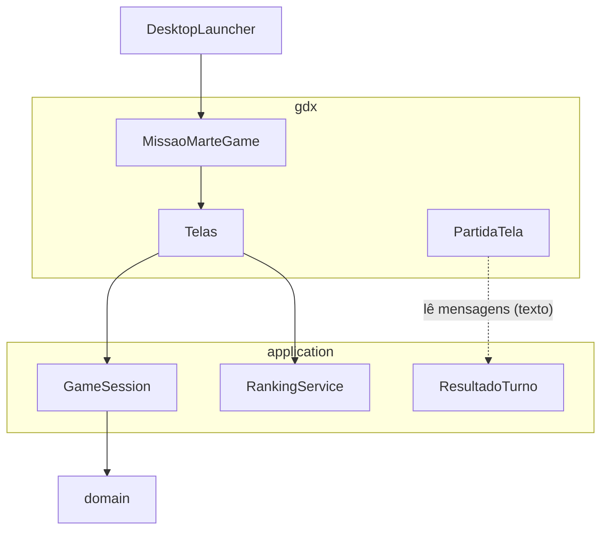
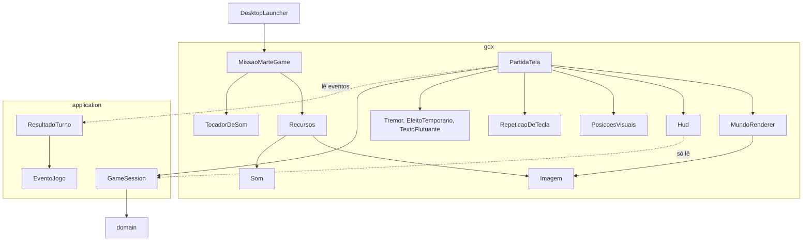

# Tutorial da fase 4: interface gráfica (MM-06)

O jogo da fase 3 ganhou sprites, animações, movimento suave, repetição de tecla, resposta visual e sonora aos eventos e um HUD. As regras são as mesmas: `domain` e `infrastructure` são idênticos aos da fase 3, e `application` só recebeu acréscimos (seção 8.5). A mesma sequência de teclas com a semente 4 dá, na fase 3 e na fase 4, os mesmos pontos, vidas e entregas a cada turno (44 pontos e 2 vidas no fim da partida no fácil).

## 8.1 Estado de origem e destino

**Antes (fase 3):** retângulos coloridos com a letra do símbolo, a nave pulando de célula em célula, painel só em texto, nenhum som. A tela lia só as mensagens de texto do turno.

**Agora (fase 4):**

```text
fase-04-interface-grafica/
├── core/assets/imagens/       17 PNG (faixas horizontais de quadros)
├── core/assets/sons/          8 WAV (7 efeitos e 1 música)
├── core/assets/CREDITOS.md    origem e licença
├── core/src/main/java/br/edu/unifor/missaomarte/
│   ├── domain/                idêntico à fase 3
│   ├── application/           EventoJogo (novo), ResultadoTurno e GameSession (acréscimos)
│   ├── infrastructure/        idêntico à fase 3
│   └── gdx/                   catálogo (Imagem, Som), Recursos, TocadorDeSom, MundoRenderer, Hud,
│                              PosicoesVisuais, RepeticaoDeTecla, Tremor, EfeitoTemporario, TextoFlutuante
│                              e as telas da fase 3 adaptadas
├── lwjgl3/                    DesktopLauncher (semente e áudio); core/assets no classpath
└── tools/GeradorDeAssets.java gera todos os assets
```

| Fase 3 | Fase 4 |
|---|---|
| retângulo colorido com a letra | sprite escolhido por `Imagem.doSimbolo(simbolo)` |
| nave sem direção | nave girada pela última direção, com o propulsor animado atrás |
| base e inimigo parados | animação em laço (`Animation.getKeyFrame(tempo, true)`) |
| nave pula de célula | `PosicoesVisuais`: o desenho persegue a posição lógica a 12 células/s |
| uma tecla, um turno | segurar repete (`RepeticaoDeTecla`), cada repetição um turno |
| mensagem de texto | `ResultadoTurno.eventos()` (MOVIMENTO, EMBARQUE, ENTREGA, COLISAO, VITORIA, DERROTA) |
| colisão só na mensagem | explosão, tremor, flash vermelho, nave piscando e som |
| painel de texto | `Hud`: barra superior, painel lateral com ícones e barra de entregas, rodapé |
| sem som | `TocadorDeSom`, música em laço, `M` para silenciar, `-Dmissaomarte.semaudio=true` |
| fundo liso | `fundo.png` em todas as telas, nave animada no menu |

Antes:



Depois:



A regra de dependência continua: só `gdx` e `lwjgl3` importam `com.badlogic`. As classes de `gdx` sem libGDX (`Imagem`, `Som`, `PosicoesVisuais`, `RepeticaoDeTecla`, `Tremor`, `EfeitoTemporario`, `TextoFlutuante`, `Geometria`) são as que os testes usam.

## 8.2 Conceitos aplicados

**PNG, `Texture`, `TextureRegion` e animação.** O PNG é o arquivo no disco. O `AssetManager` o carrega numa `Texture`, que mora na memória da placa de vídeo. Uma *sprite sheet* é uma imagem com vários quadros; as nossas são faixas horizontais de quadros do mesmo tamanho (o `inimigo.png` tem 64 x 32, dois quadros de 32 x 32). O `Recursos` corta cada faixa em `TextureRegion` (um retângulo dentro da textura) e, quando há mais de um quadro, monta uma `Animation`:

```java
TextureRegion[] faixa = TextureRegion.split(textura, imagem.larguraQuadro(), imagem.alturaQuadro())[0];
quadros.put(imagem, faixa);
if (faixa.length > 1) {
    lacos.put(imagem, new Animation<>(QUADRO_LACO, faixa));
}
```

`quadroEmLaco(imagem, tempo)` chama `getKeyFrame(tempo, true)`: base, inimigo e propulsor repetem os quadros sem parar. Explosão e brilho não usam laço: o `EfeitoTemporario` diz qual quadro mostrar.

**`AssetManager`.** O `load()` só põe o arquivo numa fila; quem lê de fato é o `finishLoading()` (ou o `update()` chamado várias vezes, para uma tela de carregamento). Usar o asset antes disso dá erro. Ele não é estático porque guarda texturas e sons presos ao contexto do OpenGL e do áudio daquela aplicação: um campo estático sobreviveria ao `dispose()` (no Android, a mesma JVM pode abrir o jogo de novo) e apontaria para recursos já liberados. No nosso jogo ele é um campo do `Recursos`, criado no `MissaoMarteGame.create()` e liberado no `MissaoMarteGame.dispose()`. O log da execução mostra a carga: `[Recursos] 17 imagens e 8 sons carregados` (e `17 imagens e 0 sons` com o áudio desativado).

**`Sound` e `Music`.** O `Sound` é carregado inteiro na memória e serve para efeitos curtos que podem tocar várias vezes ao mesmo tempo (mover, embarcar, colisão). A `Music` é lida aos pedaços (*streaming*), serve para áudio longo e tem `play`, `pause`, `setLooping`. Os dois seguram recursos nativos do dispositivo de áudio, por isso precisam de `dispose()`; aqui quem libera é o `AssetManager.dispose()`, chamado uma vez pelo `Recursos`.

**Posição visual separada da lógica.** A `GameSession` muda a posição inteira da nave de uma vez, e assim tem que continuar (a colisão é por célula). O desenho usa outra posição, em células fracionárias, guardada pelas `PosicoesVisuais`. A cada quadro ela anda em linha reta até a posição lógica a 12 células por segundo, sem passar do alvo:

```java
if (distancia <= passo) {
    atual[0] = alvoX;
    atual[1] = alvoY;
} else {
    atual[0] += dx / distancia * passo;
    atual[1] += dy / distancia * passo;
}
```

O mapa é um `IdentityHashMap`: dois asteroides na mesma célula são dois objetos, e o domínio não precisou de `equals` nem de campo novo. Quem some da lista (passageiro embarcado) é esquecido; quem aparece começa no lugar. A `Geometria` da fase 3 já aceitava `float`, então a coordenada fracionária vira pixel pela mesma conta, com o Y invertido. A lógica nunca espera o desenho: a tecla chama `sessao.jogar` na hora, e o desenho alcança depois.

**HUD.** É a camada de informação desenhada por cima do mundo: vidas, pontos, tempo, som, vagas, entregas, mensagens. É desenhado depois do mundo para ficar por cima e para não tremer junto: a `PartidaTela` desloca a câmera só enquanto desenha o mundo e volta antes do HUD. O `Hud` só lê a `GameSession` (`vidas()`, `pontos()`, `duracaoSegundos()`, `aBordo()`, `capacidade()`, `entregues()`, `total()`...). Os painéis são translúcidos; o `ShapeRenderer` só mistura a transparência com o *blending* ligado:

```java
Gdx.gl.glEnable(GL20.GL_BLEND);
Gdx.gl.glBlendFunc(GL20.GL_SRC_ALPHA, GL20.GL_ONE_MINUS_SRC_ALPHA);
// ... retângulos com alfa ...
Gdx.gl.glDisable(GL20.GL_BLEND);
```

**Por que a colisão não usa `Intersector`.** No nosso jogo a colisão é uma regra do domínio: `Missao.naveColidiu()` compara a célula da nave com a dos asteroides e inimigos. Jogos de ação usam `Intersector` (retângulos ou círculos que se sobrepõem em pixels), porque lá a posição é contínua. Aqui a posição de verdade é a célula; a posição visual é só desenho e fica no meio do caminho durante o deslizamento. Testar a colisão com `Intersector` sobre as posições visuais criaria uma segunda regra, que podia disparar entre duas células ou não disparar quando a lógica já disse que colidiu. A tela só responde ao evento `COLISAO` que a `GameSession` informou.

**Por que o `ResultadoTurno` passou a trazer eventos.** Para tocar o som de colisão sem eventos, a tela teria que procurar "Colisão" no texto da mensagem: a regra ("houve colisão?") passaria a depender de uma frase, e mudar a frase quebraria o som. Com eventos, a `GameSession` diz o que aconteceu numa lista de enums e a tela só reage. A mudança é aditiva: o construtor antigo `ResultadoTurno(List<String>)` continua e devolve a lista de eventos vazia, e a `GameSession` só compara o estado antes e depois das mesmas chamadas de sempre:

```java
if (missao.restantes() < noMapa) {
    eventos.add(EventoJogo.EMBARQUE);
}
desembarcar(mensagens);
if (missao.entregues() > entreguesAntes) {
    eventos.add(EventoJogo.ENTREGA);
}
```

## 8.3 Decisões de projeto

**Origem dos assets.** Todos foram gerados por código pela equipe (`tools/GeradorDeAssets.java`): desenhos com `java.awt` em pixel art de 32 x 32 (ícones de 16 x 16, fundo de 800 x 600) e sons como ondas simples gravadas em WAV PCM de 16 bits. Sem arte ou som de terceiros, então não há licença de terceiros a respeitar; `core/assets/CREDITOS.md` registra autor, origem e licença. O gerador fica fora do build, sobrescreve os arquivos e é determinístico (as estrelas do fundo usam semente fixa e as letras dos passageiros são desenhadas pixel a pixel, sem depender das fontes da máquina), então rodar de novo não muda nada no `git status`.

**Texturas na camada `gdx`, não nas entidades.** O domínio não pode depender do libGDX (a fase 5 leva as regras para um servidor e a fase 6 para o Android, e os testes rodam sem OpenGL). Se a `Nave` guardasse uma `Texture`, ela só existiria com um contexto OpenGL aberto. Por isso a imagem é escolhida na hora de desenhar, pelo `MundoRenderer`, e a textura mora no `Recursos`.

**Sprite pelo símbolo, sem `instanceof`.** `Imagem.doSimbolo(char)` traduz o símbolo que cada `ElementoMapa` já informa (`'@'`, `'L'`, `'#'`, `'X'`, `'P'`, `'E'`, `'T'`) e devolve `DESCONHECIDO` para qualquer outro. Um elemento novo no domínio aparece com a imagem genérica sem quebrar nada, e a escolha fica num `switch` testável sem janela, em vez de uma cadeia de `instanceof` que precisaria conhecer cada classe. O `ElementoMapa.simbolo()` faz o papel do `ObjetoRenderizavel#getSimbolo()` do enunciado (decisão da fase 3: criar outra interface mudaria o `domain`).

**Fonte no jogo, não no `Recursos`.** A `BitmapFont` padrão (que já tem os acentos) continua sendo criada no `MissaoMarteGame.create()` e liberada no `dispose()`, como na fase 3; ela não vem de arquivo nosso, então não passa pelo `AssetManager`.

**Atalho de silenciar central, com a tela de nome de fora.** O `M` é tratado uma vez, no `InputAdapter` da `TelaBase`, antes de a tela ver a tecla. Se cada tela tratasse, bastaria uma esquecer. A `NovaPartidaTela` devolve falso em `aceitaAtalhoDeSom()`, porque lá o `M` é letra do nome. Conferido: digitar `m` no nome inseriu a letra e não gerou a linha `Som: desligado` no log (captura `f4-nova-partida.png`).

**Padrões usados.**

| Padrão | Onde | Segue de fato ou só parece? |
|---|---|---|
| Domain Event | `EventoJogo` na lista do `ResultadoTurno` | Parece mais do que segue: são fatos do turno, mas devolvidos junto com o resultado, sem publicador nem assinantes. |
| Facade | `Recursos` esconde o `AssetManager`, o corte das faixas e as animações atrás de `quadro`, `quadroEmLaco`, `som`, `musica` | Segue: as telas não conhecem o `AssetManager`. |
| Template Method | `TelaBase` (ciclo de vida, viewport, teclado, atalho `M`) com os ganchos `desenhar`, `teclaApertada`, `teclaSolta`, `aceitaAtalhoDeSom` | Segue. |
| State | telas trocadas por `trocarTela` | Segue (da fase 3). |
| Injeção de dependência | launcher monta fábrica, ranking, `Random`, `Clock` e a escolha do áudio; `MundoRenderer` e `Hud` recebem `Recursos` pelo construtor | Segue (manual). |
| Null Object | `TocadorDeSom` com áudio desativado vira "não faz nada" | Só parece: é o mesmo objeto com uma flag, não uma classe nula separada. |

## 8.4 Passo a passo

Mesmo ambiente da fase 3 (Git Bash com `JAVA_HOME` do JDK 17 e o `JAVA_TOOL_OPTIONS` do socket local).

1. **Branch e cópia.** `git checkout -b mm-06-interface` a partir da `mm-04-libgdx` e cópia da fase 3 para `fase-04-interface-grafica` (sem `build/`, capturas e evidências).
2. **Problema real: fim de linha.** A primeira cópia foi feita com `git archive`, que no Windows com `core.autocrlf=true` grava CRLF; o `diff -r` contra a fase 3 (gravada com LF) acusou todos os arquivos de `domain` como diferentes. Converti a cópia de volta para LF (`dos2unix`), e o `diff -r` ficou vazio. O hash por `sha256sum` também passou a bater.
3. **Eventos em `application`.** `EventoJogo` novo; `ResultadoTurno` ganhou o segundo componente e o construtor antigo; `GameSession.jogar` ganhou as comparações de antes e depois. As saídas de `SAIR` e `INVALIDA` continuam com `new ResultadoTurno(mensagens)`, sem eventos. O `git diff --no-index` contra a fase 3 só tem duas linhas removidas: o `return new ResultadoTurno(mensagens);` do fim do `jogar` e a declaração do record.
4. **Assets.** Escrevi o gerador e rodei `java tools/GeradorDeAssets.java` duas vezes, comparando o `sha1sum` dos 25 arquivos: iguais. A primeira versão escrevia as letras dos passageiros com `drawString`, que depende das fontes instaladas; troquei por letras de 3 x 5 pixels desenhadas à mão, para o resultado ser o mesmo em qualquer máquina.
5. **Problema real: o compilador recusou o `load` com operador ternário.** `assets.load(caminho, som.musica() ? Music.class : Sound.class)` não compila: o tipo do ternário vira `Class<? extends ...>` e não casa com o genérico do `load`. Troquei por um `if`.
6. **Testes.** Os 36 novos passaram no primeiro build depois do ajuste acima, junto com os 38 herdados: `74 0 0`. Na revisão do diff entrou o 37º, a derrota por pontos zerados (o outro caminho de derrota da `GameSession`): `75 0 0`. Antes de rodar, troquei um passo de tempo de 0,01 s por 0,02 s no `RepeticaoDeTeclaTest`, porque com `float` a soma `0,14 - 0,13 - 0,01` pode sobrar positiva e o teste dependeria do arredondamento.
7. **Problema real: a barra de entregas encostava no texto.** Na primeira captura (`f4-partida-inicio.png`) a barra de progresso ficava colada na linha "Entregas" e "Restantes no mapa" quase a tocava. Desci a barra e as linhas de baixo (captura `f4-semaudio.png`, já com o ajuste).
8. **Execução com semente 4 e sons** (seção 8.5), depois **sem áudio** com a mesma semente e as mesmas teclas: os turnos repetiram linha a linha.

## 8.5 Testes e evidências

**Testes (75: 38 herdados da fase 3 sem alteração e 37 novos; nenhum abre janela, usa OpenGL ou toca áudio).**

| Classe | Testes | O que cobre |
|---|---|---|
| herdados (fase 3) | 38 | sessão, fábrica, ação, nave, posição, ranking em arquivo, ranking em memória, teclado, geometria |
| `GameSessionEventosTest` | 13 | cada evento; derrota por pontos zerados; borda sem movimento mas com ponto cobrado; embarcar sem passageiro sem evento; inválido e sair sem eventos; duração parada no fim (relógio manual); missão sem passageiro nasce vencida; construtor antigo do `ResultadoTurno` |
| `AssetsTest` | 4 | cada imagem do catálogo existe e tem largura = quadro x quadros e altura = quadro (lida com `ImageIO`); cada som existe e é áudio válido (`AudioSystem.getAudioFileFormat`, sem tocar); uma única música; quadros mínimos do enunciado |
| `ImagemTest` | 2 | símbolo de cada objeto do domínio para a imagem; símbolo desconhecido para a genérica |
| `PosicoesVisuaisTest` | 4 | objeto novo não desliza; desliza meia célula em 1/24 s e para no alvo; diagonal em linha reta; esquece quem sumiu, por identidade |
| `EfeitosTest` | 5 | quadros espalhados pela duração; remoção ao terminar; nave piscando; texto sobe (Y diminui) e fica transparente; variação de 1 não vira texto |
| `TremorTest` | 2 | começa forte, cai pela metade, termina em zero; deslocamento dentro da amplitude |
| `RepeticaoDeTeclaTest` | 5 | sem tecla não repete; atraso de 0,28 s; intervalo de 0,14 s; no máximo uma repetição por chamada; soltar para e recomeça com atraso |
| `GeometriaFracionariaTest` | 2 | meia célula em X; meia célula para cima no jogo sobe 24 px na tela |

`diff -r ../fase-03-libgdx/core/src/test core/src/test` só mostra `Only in` (arquivos novos).

**`./gradlew clean build`** (inteiro em `docs/evidencias/saida-clean-build.txt`): `BUILD SUCCESSFUL`, e a soma dos relatórios (comando no fim do mesmo arquivo) dá `75 0 0`.

**Hash.** `docs/evidencias/hash-fase-03-x-fase-04.txt`: dos 20 arquivos de `domain`, `application` e `infrastructure` da fase 3, 18 dão `OK` e só `GameSession.java` e `ResultadoTurno.java` dão `FAILED`, que são os dois alterados de propósito; `EventoJogo.java` é o único novo. `diff -r` de `domain` e de `infrastructure` sai vazio.

**Capturas** (`docs/capturas`): `f4-menu.png` (fundo e nave animada), `f4-menu-mudo.png` (depois do `M`), `f4-nova-partida.png` (o `m` no nome), `f4-partida-inicio.png` (sprites e HUD), `f4-deslizando.png` (nave girada para a esquerda), `f4-embarque.png` (brilho, "+10" e uma vaga preenchida), `f4-entrega.png` ("Entregue!" e a barra de entregas), `f4-colisao.png` (explosão, mapa deslocado pelo tremor, coração vazio), `f4-vitoria.png`, `f4-ranking-resumo.png`, `f4-derrota.png`, `f4-semaudio.png`, `f4-redimensionada.png` (1200 x 900).

**Sequência de eventos com semente 4** (`./gradlew :lwjgl3:run --console=plain -Dmissaomarte.semente=4`, log inteiro em `docs/evidencias/saida-run-semente-4.txt`):

```text
[MissaoMarte] create()
[Recursos] 17 imagens e 8 sons carregados
[Tela] Som: desligado (M)
[Tela] Som: ligado (M)
[Menu] ranking limpo
[Partida] ESQUERDA -> [MOVIMENTO] pontos 29, vidas 3, a bordo 0, entregues 0/4
...
[Partida] CIMA -> [MOVIMENTO] pontos 24, vidas 3, a bordo 0, entregues 0/4
[Partida] EMBARCAR -> [EMBARQUE] pontos 34, vidas 3, a bordo 1, entregues 0/4
...
[Partida] DIREITA -> [MOVIMENTO, ENTREGA] pontos 28, vidas 3, a bordo 0, entregues 1/4
...
[Partida] EMBARCAR -> [EMBARQUE] pontos 44, vidas 3, a bordo 2, entregues 1/4
[Partida] ESQUERDA -> [MOVIMENTO, COLISAO] pontos 43, vidas 2, a bordo 2, entregues 1/4
...
[Partida] CIMA -> [MOVIMENTO, ENTREGA, VITORIA] pontos 44, vidas 2, a bordo 0, entregues 4/4
[Partida] vitória registrada no ranking com 65 s: Você entrou no Top 5!
...
[Partida] DIREITA -> [MOVIMENTO, COLISAO] pontos 44, vidas 2, a bordo 0, entregues 0/5
[Partida] EMBARCAR -> [COLISAO] pontos 44, vidas 1, a bordo 0, entregues 0/5
[Partida] EMBARCAR -> [COLISAO, DERROTA] pontos 44, vidas 0, a bordo 0, entregues 0/5
```

Os pontos e vidas de cada turno são os mesmos da fase 3 com a mesma semente e as mesmas teclas (`fase-03-libgdx/docs/evidencias/saida-run-semente-4.txt`).

**Roteiro de validação (17 passos).**

| Passo | Resultado | Evidência |
|---|---|---|
| 1. `--version` | Gradle 8.7, JVM 17.0.21.1 | `saida-clean-build.txt` |
| 2. `clean build` | `BUILD SUCCESSFUL`, 75 testes, 0 falhas | `saida-clean-build.txt` |
| 3. abre a janela e conta os assets | `17 imagens e 8 sons carregados`, nenhuma exceção no log | `saida-run-semente-4.txt` |
| 4. menu com fundo, nave animada, música; `M` | `Som: desligado (M)` e `Som: ligado (M)` no log | `f4-menu.png`, `f4-menu-mudo.png` |
| 5. `m` no nome | a letra entrou ("mArthurm_") e o log não mudou o som | `f4-nova-partida.png` |
| 6. sprites, nave gira e desliza | nave apontando para a esquerda depois do `A` | `f4-deslizando.png` |
| 7. segurar a tecla | o script segurou o `A` por 0,6 s (um único aperto, sem soltar) e o log mostra 4 turnos seguidos, de 28 a 25 pontos, 1 ponto cada: o primeiro do aperto e 3 repetições (o log não marca qual turno é repetição) | `saida-run-semente-4.txt` |
| 8. embarque | brilho, "+10", vaga preenchida, `[EMBARQUE]` | `f4-embarque.png` |
| 9. entrega | "Entregue!", barra em 1/4, `[MOVIMENTO, ENTREGA]` | `f4-entrega.png` |
| 10. colisão | explosão, mapa deslocado (tremor), coração vazio, `[MOVIMENTO, COLISAO]`; sem texto "-pontos" (ver 8.6, item 6) | `f4-colisao.png` |
| 11. vitória e derrota | caixa de vitória, ranking com resumo; derrota com caixa e Enter para o menu | `f4-vitoria.png`, `f4-ranking-resumo.png`, `f4-derrota.png` |
| 12. tempo do resumo = tempo gravado | resumo "65 s" e `ranking.json` com `"tempoJogo":65` | `f4-ranking-resumo.png` |
| 13. mesma semente, mesmo cenário | a execução sem áudio repetiu as 20 primeiras linhas de turno da execução com áudio | `saida-run-semaudio.txt` |
| 14. áudio desativado | `create() sem áudio`, `17 imagens e 0 sons`, `Som: desativado`, sem exceção | `saida-run-semaudio.txt`, `f4-semaudio.png` |
| 15. redimensionar | `resize(1200, 900)`, mapa 1,5 vez maior na mesma proporção | `f4-redimensionada.png` |
| 16. `com.badlogic` só em `gdx`/`lwjgl3` | `grep` vazio em `domain`, `application`, `infrastructure` | comando |
| 17. fases anteriores intactas | `git diff --stat mm-03-gradle HEAD -- fases/fase-00-console fases/fase-01-refatoracao fases/fase-02-gradle` sem saída; a fase 3 também não mudou nesta branch | comando |

O que **não** foi verificado: o som e a música não foram ouvidos (a máquina tocou sem erro no log, mas ninguém escutou); as teclas foram mandadas por mensagem direta à janela, não por um teclado físico; o flash vermelho dura 0,3 s e não apareceu em nenhuma captura; a pausa da música na vitória e a volta no menu estão no código (`TocadorDeSom.pausarMusica` e `MenuTela.show`), mas só dá para conferir ouvindo. A comparação por hash dos nossos assets com os do referencial da disciplina não foi feita: a ferramenta desta sessão bloqueou a leitura da pasta de assets do referencial, que a equipe também combinou de não abrir; como os arquivos saem do nosso gerador, a origem está registrada em `CREDITOS.md`.

## 8.6 Limitações e próximos passos

1. **Arte e som simples.** Pixel art e tons gerados por código, sem artista nem mixagem. Na fase 6 (Android) a tela é menor e de toque: os sprites de 32 px esticados para 48 px e os botões de teclado do rodapé vão precisar de revisão.
2. **Fonte serrilhada e com glifos faltando.** A `BitmapFont` padrão tem acentos, mas não o emoji "✨" de uma mensagem da `GameSession`, que vira um quadrado; ampliada (janela grande) fica serrilhada. Uma fonte própria (`gdx-freetype`) resolveria; na fase 5, as mensagens que vierem do servidor de ranking também vão passar por essa fonte.
3. **Mensagens da aplicação em texto pronto.** Os eventos não carregam dados (quantos pontos, quantos entregues); a tela calcula a variação de pontos pela diferença da `GameSession`. Na fase 5 o servidor vai precisar de dados da partida, não de frases: eventos com dados seriam o caminho.
4. **Sem tela de carregamento.** O `finishLoading()` trava a primeira imagem até carregar tudo. Com poucos arquivos é rápido no desktop; no Android (fase 6) uma tela com `AssetManager.update()` evita a tela preta.
5. **Ciclo de vida do áudio no Android.** No desktop o `pause()` não para a música; no Android, ao ir para segundo plano, a música precisa pausar no `pause()` e voltar no `resume()` (fase 6).
6. **Colisão sem texto de pontos.** O enunciado pede o texto flutuante com a variação de pontos na colisão ("-6"). Na regra da equipe a colisão tira uma vida, não pontos: o turno da colisão varia só o -1 do movimento, que o filtro de |variação| > 1 esconde. Mudar a regra para ter o texto está fora de cogitação; a alternativa seria mostrar a vida perdida ("-1 vida"), que ficou para depois.
7. **Efeitos na posição lógica.** Explosão e brilho aparecem na célula de destino enquanto a nave ainda desliza (cerca de 80 ms), e o tremor também desloca o fundo, mostrando a cor de limpeza na borda por até 8 px. São só visuais.
