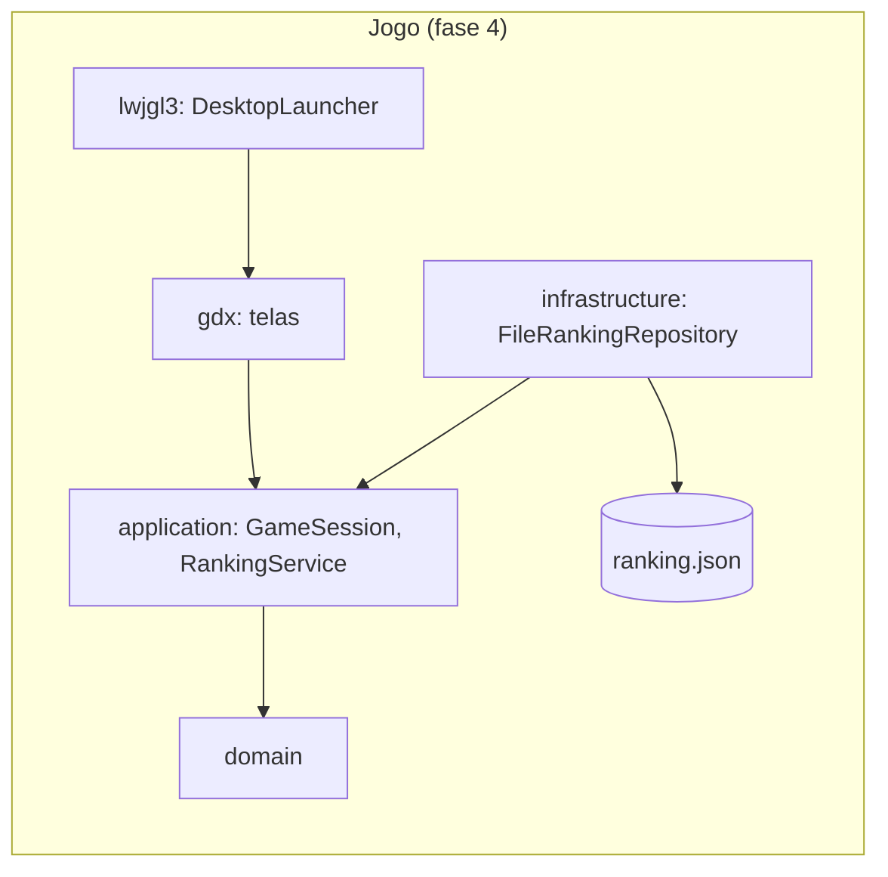
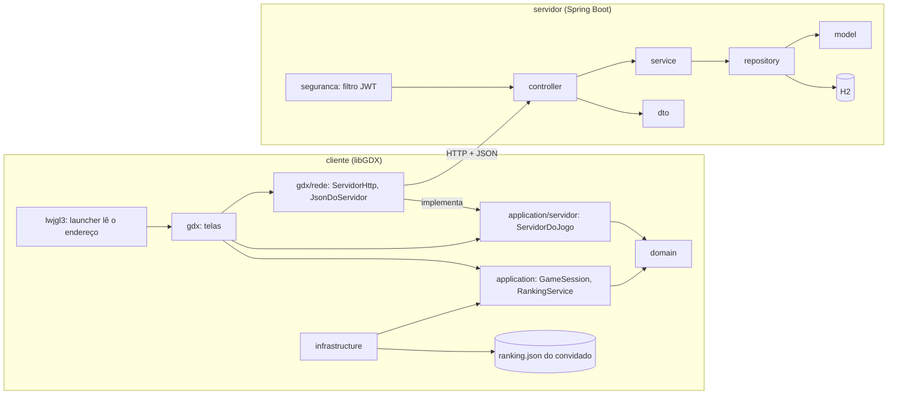

# Tutorial da fase 5: servidor e ranking global

Na fase 4 o ranking era um arquivo `ranking.json` na máquina de quem joga, sem usuário nenhum. Na fase 5 um
servidor Spring Boot guarda contas e partidas e monta um ranking global, e o jogo libGDX passa a ter dois modos:
convidado, igual à fase 4, e logado, que conversa com o servidor sem travar a tela.

Os dois projetos ficam em `servidor/` e `cliente/` (por que separados: seção 8.4). Os comandos estão no
`README.md` da fase; a API completa, no `servidor/README.md`.

## 8.1 Estado de origem e destino

| Fase 4 | Fase 5 |
|---|---|
| `ranking.json` na pasta do jogo | banco H2 do servidor (`servidor/dados/`), e o `ranking.json` continua para o convidado |
| nome digitado a cada partida | nome da conta (o convidado ainda digita) |
| ranking lido do arquivo, na hora (síncrono) | ranking pedido ao servidor, com resposta depois (assíncrono), e estados carregando, pronto e erro |
| só a vitória entra no ranking | logado envia vitória e derrota (o histórico mostra as duas); o ranking global usa só vitórias |
| Top 5 por máquina | Top 10 global, uma linha por jogador, com a melhor vitória |
| sem identidade | cadastro, login, senha em BCrypt e token JWT de 2 horas |
| menu de 4 opções | menu de 5 opções, diferente para convidado e logado |

Antes (fase 4): tudo num processo só, e a regra de dependência aponta para dentro (`gdx` e `lwjgl3`
conhecem `application`, que conhece `domain`).

Depois (fase 5): o cliente ganhou uma porta (`ServidorDoJogo`) em `application`, e o adaptador HTTP
(`ServidorHttp`) mora em `gdx/rede`, porque usa o `Net` do libGDX. O servidor é outro processo, com as suas
camadas, e o único acordo entre os dois é o JSON da API.

`domain`, `application` (fora o pacote novo) e `infrastructure` continuam sem `com.badlogic` e são
idênticos aos da fase 4 (seção 8.6).

## 8.2 Conceitos aplicados

**API REST e códigos.** O servidor expõe recursos por URL e verbo HTTP: `POST /api/usuarios` cria,
`GET /api/ranking` lê. O código da resposta diz o que houve: **200** deu certo e veio conteúdo (login,
ranking, histórico); **201** criou algo (conta, partida); **400** o pedido está errado (nome curto, enum
inválido, JSON quebrado), e o corpo diz qual campo; **401** falta o token, ele é inválido ou expirou, ou o
login não confere; **409** conflito, aqui só o nome já usado, sem diferenciar maiúscula. No cliente,
`ServidorHttp.converter` transforma cada código numa `Resposta`: 2xx vira valor, 401 vira erro com a marca
`naoAutorizado`, o resto vira erro com a mensagem do servidor.

**Camadas do servidor e DTO.** `controller` recebe o HTTP e só conhece DTOs e serviços; `service` tem as
regras (cadastrar, autenticar, registrar partida, montar o ranking); `repository` fala com o banco; `model`
são as entidades JPA. O DTO (`CadastroRequest`, `PartidaResponse`, `RankingResponse`...) é o formato que
viaja na rede: a entidade `Usuario` tem o hash da senha, e por isso nunca sai pela API (critério 5 do
servidor: nenhum controller importa `servidor.model`).

**JPA e a consulta do ranking.** O JPA (Hibernate) mapeia as classes `Usuario` e `Partida` para tabelas e
gera o SQL dos métodos do repositório. O ranking escolhe a melhor vitória de cada jogador **em Java**, sobre
uma consulta já ordenada, e não pela subconsulta sugerida no enunciado: o `PartidaRepository` devolve as
vitórias com pontuação maior que zero ordenadas por pontuação (maior primeiro), duração (menor primeiro),
data (mais antiga primeiro) e id; o `PartidaService` percorre a lista e fica com a primeira de cada jogador
até juntar 10. Como a ordem já é a do ranking, a primeira de cada jogador é a melhor dele, e o id no fim da
ordem impede o mesmo jogador de aparecer duas vezes com duas vitórias iguais. Visto no roteiro: o
`piloto_dois` tem duas vitórias de 44 pontos (12 s e 27 s) e aparece uma vez só, com a de 12 s
(`capturas/f5-ranking-dois-jogadores.png`).

**Hash, sal e custo.** A senha não é guardada: o servidor guarda o resultado do BCrypt
(`new BCryptPasswordEncoder(10)`). Hash é uma função de mão única: dá para conferir se uma senha bate, não dá
para voltar do hash para a senha. O sal é um valor aleatório misturado a cada senha (fica dentro do próprio
hash), então duas pessoas com a mesma senha têm hashes diferentes e uma tabela pronta de hashes não serve. O
custo (10) diz quantas rodadas o BCrypt faz: deixa cada tentativa lenta de propósito, o que atrapalha quem
tenta adivinhar senhas com o banco vazado. Não se **criptografa** senha porque criptografia volta atrás com a
chave: quem pegar banco e chave lê todas. O BCrypt só lê os primeiros **72 bytes**; por isso o servidor
recusa senha maior (`Ate72Bytes`) e o formulário do cliente para de aceitar caractere no byte 72
(`FormularioDeLogin.digitar`). A OWASP prefere Argon2id para sistemas novos porque ele também gasta memória,
o que encarece ataques com placa de vídeo; o BCrypt continua aceitável e é o que o enunciado pede. No banco
das provas, os dois hashes começam com `$2a$10$`, têm 60 caracteres e não contêm a senha
(`evidencias/saida-banco-bcrypt.txt`).

**JWT e "sem estado".** O login devolve um token JWT assinado com HS256: três partes em Base64 (cabeçalho,
conteúdo, assinatura). O conteúdo tem `sub` (id do usuário), `nome`, `iat` e `exp` (2 horas), e nada de
senha. "Sem estado" quer dizer que o servidor não guarda sessão: cada pedido traz o token no cabeçalho
`Authorization: Bearer ...`, e a assinatura prova que foi o servidor que o emitiu. Se o token vazar, quem o
tiver joga em nome do dono até ele expirar, porque não há como revogar (seção 8.3). No cliente, o token fica
só na memória, dentro da `Sessao`, cujo `toString` não o mostra (`SessaoTest`).

**Validar de novo no servidor.** O cliente valida nome e senha antes de enviar (`FormularioDeLogin.validar`),
mas isso só poupa uma viagem: qualquer um pode chamar a API com `curl` e mandar o que quiser. Por isso o
servidor valida tudo de novo (Bean Validation nos DTOs) e é a única fonte confiável.

**Rede assíncrona e `postRunnable`.** `Gdx.net.sendHttpRequest` volta na hora e a resposta chega depois,
noutra thread. Se o jogo esperasse, a tela congelaria até o servidor responder (ou até o tempo limite de
5 s com o servidor desligado). O código que mexe na tela só pode rodar na thread do jogo, então o adaptador
lê o corpo dentro do `handleHttpResponse` (a conexão fecha logo depois) e entrega o resultado pronto por um
`Executor`, que no jogo é `Gdx.app::postRunnable` (`MissaoMarteGame.create`). Os três desfechos
(`handleHttpResponse`, `failed`, `cancelled`) passam pelo executor (`ServidorHttp.enviar`).

**Port and Adapter.** A porta é a interface `ServidorDoJogo` em `application/servidor`: diz o que o jogo
precisa do servidor (cadastrar, entrar, enviar partida, carregar ranking e histórico), sem libGDX nem HTTP. O
adaptador é o `ServidorHttp`, em `gdx/rede`, que implementa a porta com o `Net` do libGDX e o
`JsonDoServidor`. As telas e o `EnvioDaPartida` só conhecem a porta, por isso o `EnvioDaPartidaTest` usa um
servidor falso e o `ServidorHttpTest` usa um `Net` falso, sem rede.

## 8.3 Decisões e limitações de segurança

| ameaça | como foi tratada |
|---|---|
| banco vazado | só o hash BCrypt com sal e custo 10; a senha nunca é gravada, logada nem impressa (`toString` dos DTOs de entrada sem a senha) |
| enumeração de usuários | login com nome inexistente confere a senha contra um hash falso e responde o mesmo 401 "Usuário ou senha inválidos." da senha errada; o cliente mostra só esse texto (`capturas/f5-senha-errada.png`) |
| token falsificado ou expirado | assinatura HS256 conferida em toda rota protegida; expirado ou alterado dá 401; o cliente descarta a sessão e avisa "Sessão expirada" |
| gravar partida em nome de outro | o dono da partida vem do `sub` do token; um campo `usuario` no corpo é ignorado |
| JSON malicioso | no servidor, validação de cada campo, enum só pelo nome, número só inteiro, e erro sem a mensagem interna; no cliente, o JSON enviado é sempre do `JsonWriter` (uma senha `a"b\c` não quebra a estrutura, `JsonDoServidorTest`), e resposta cortada, vazia ou HTML vira mensagem padrão, nunca o corpo bruto |
| tudo aberto por esquecimento | o filtro exige token em toda rota; só `POST /api/usuarios`, `POST /api/auth/login` e `/error` são públicas, declaradas num método só |

O que **não** foi tratado:

- **Pontuação falsificada.** O servidor guarda o número que o cliente manda;
  ele não executa a lógica do jogo. Qualquer pessoa com um token pode mandar `"pontuacao": 100000`. A defesa exigiria o servidor
  reproduzir a partida (receber semente e jogadas e recalcular) ou um cliente que não dá para alterar, e
  nenhum dos dois cabe nesta fase.
- **HTTPS.** O tráfego é HTTP em texto claro: senha e token viajam legíveis na rede. Serve para rodar na
  própria máquina (o servidor escuta só em `127.0.0.1` por padrão).
- **Força bruta no login.** Não há limite de tentativas; o custo do BCrypt só deixa cada tentativa mais lenta.
- **Renovação e revogação de token.** O token vale 2 horas e não há como cancelar antes; depois disso, o
  jogador entra de novo.
- **Fila de reenvio.** Se o envio falhar e o jogador apertar `Enter` em vez de `R`, aquele resultado se perde
  (visto no roteiro, passo 11).

**Segredo por variável de ambiente.** O segredo que assina os tokens fica em `MISSAOMARTE_JWT_SEGREDO`,
fora do código e do Git: quem lê o repositório não consegue fabricar tokens. Sem a variável, o servidor gera
um segredo aleatório a cada subida e avisa no log; o único segredo versionado é o de teste, no
`application-test.properties`.

## 8.4 Decisões de projeto

**Dois builds independentes.** O plugin do Spring Boot 4 exige Gradle 9, e o cliente usa o Gradle 8.7 que o
libGDX 1.12.1 e as fases 3 e 4 já usam. Separados, cada um tem o seu wrapper, compila e testa sozinho, e o
servidor não depende de nada do cliente (`grep` do critério 6 do servidor vazio).

**Cópia própria do enum de dificuldade no servidor.** Se o servidor importasse o `Dificuldade` do cliente,
os dois builds ficariam amarrados e uma mudança no jogo (um nome novo na tela, um número de inimigos)
mexeria no servidor. O que os dois combinam é só o texto `FACIL`, `MEDIO`, `DIFICIL`, que é contrato da API.

**Modo convidado mantido.** O enunciado pede, e ele deixa o jogo jogável sem rede (passo 12 do roteiro). O
custo: o jogo inteiro passou a perguntar "tem sessão?" (`MissaoMarteGame.logado()`) no menu, na nova
partida, no fim da partida e no ranking, que agora tem dois caminhos (local síncrono e global assíncrono), e o
menu ganhou duas listas de opções (`OpcoesDoMenu`).

**Padrões usados.**

| padrão | onde | segue mesmo? |
|---|---|---|
| Port and Adapter | `ServidorDoJogo` (porta) e `ServidorHttp` (adaptador) | segue: as telas só conhecem a porta, e os testes trocam o adaptador |
| Repository | `RankingRepository`/`FileRankingRepository` no cliente; `UsuarioRepository` e `PartidaRepository` no servidor | segue |
| DTO | records do pacote `dto` do servidor | segue: entidade não sai pela API |
| Callback | `Retorno<T>` em toda operação da porta | segue |
| State | `EnvioDaPartida.Estado` (enviando, enviado, falhou) e `EstadoDaCarga` | parece, não segue: é um enum consultado com `switch`, e não um objeto por estado com comportamento próprio. Para três estados, é mais simples assim |
| Injeção de dependência | o launcher monta fábrica, ranking, relógio e endereço e passa ao `MissaoMarteGame`; no servidor, o Spring injeta pelo construtor | segue, sem framework no cliente (feita à mão no composition root) |
| Template Method | `TelaBase` com os ganchos `desenhar`, `teclaApertada`, `caractereDigitado`, `aceitaAtalhoDeSom` | segue (vem da fase 4) |

## 8.5 Passo a passo

1. **Servidor** (parte A, PR do servidor). Wrapper 9.8.2 gerado com o Gradle 8.7 do cache, `build.gradle`
   com os starters do Boot 4, modelo e repositórios, cadastro, login, JWT e segurança, partidas, histórico e
   ranking, cada passo com os testes; 49 testes no fim. Os problemas dessa parte estão na tabela abaixo,
   tirada de `servidor/docs/evidencias.md`, seção 10.
2. **Cópia da fase 4 para `cliente/`** por `git archive` da branch da fase 4 (sem `build`, `.gradle`,
   `ranking.json` e `docs`), e build verde sem mudança nenhuma: 75 testes.
3. **Porta e tipos de apoio** em `application/servidor` (`ServidorDoJogo`, `Retorno`, `Resposta`, `Sessao`,
   `PartidaConcluida`, `PartidaRegistrada`, `LinhaDoRanking`, `EnvioDaPartida`), com testes: 91.
4. **Adaptador e JSON** em `gdx/rede` (`ServidorHttp` e `JsonDoServidor`), com um `Net` falso no teste: 122.
5. **Classes sem libGDX das telas** (`FormularioDeLogin`, `FormatoDoHistorico`, `OpcoesDoMenu`,
   `EstadoDaCarga`), com testes; depois as telas (`EntrarTela`, `HistoricoTela`) e as alterações no menu, na
   nova partida, no fim da partida, no ranking, no jogo e no launcher: 139.
6. **Roteiro na janela** com o servidor da parte A no ar (seção "Roteiro de validação"). O passo 11 mostrou um
   erro real, corrigido com teste: 140.
7. **Documentação** (este tutorial, o README da fase e a linha da fase 5 no README da raiz).

Problemas encontrados e como foram resolvidos:

| problema | como apareceu | solução |
|---|---|---|
| Plugin do Spring Boot 4 não roda no Gradle 8.7 e não há `gradle` no `PATH` | enunciado e cache local | Gradle 8.7 do cache pelo caminho inteiro gera o wrapper 9.8.2, e o `./gradlew wrapper` regrava jar e scripts |
| Wrapper e Git do Windows trocam o fim de linha | `gradlew` e `roteiro-api.sh` com CRLF quebram no `bash` | `.gitattributes` com LF para `gradlew` e `*.sh`, CRLF para `*.bat` |
| Starter com nome antigo | enunciado | `spring-boot-starter-webmvc` (não `-web`) e os starters de teste novos |
| `MockMvc` ausente nos testes | `@SpringBootTest` sozinho no Boot 4 | `@AutoConfigureMockMvc` |
| Resource server só aceita RS256 | enunciado | `JwtEncoder` e `JwtDecoder` com a mesma chave HS256 |
| 401 do token com corpo vazio | padrão do Spring Security | ponto de entrada próprio que mantém o `WWW-Authenticate` e escreve o `ProblemDetail` (o cliente aceita corpo vazio do mesmo jeito: `ServidorHttpTest.naoAutorizadoComCorpoVazioCaiNoTextoPorCodigo`) |
| JSON cortado virava erro de campo; `"resultado":0` gravava `VITORIA`; página distante dava 500 | `curl` e revisão de contexto limpo no servidor | tratador de erros, três chaves `spring.jackson.*` e lista vazia no serviço, cada um com teste |
| **Servidor desligado mostrava "código -1" no fim da partida** | roteiro, passo 11, na janela (`capturas` não guardam a tela errada; o log da execução C mostra a partida) | com a porta fechada, o `Net` do LWJGL3 não chama `failed`: chama `handleHttpResponse` com status -1. O `ServidorHttp` trata status abaixo de 100 como "Não foi possível conectar ao servidor." Teste `statusMenosUmDoDesktopViraFalhaDeConexao` |
| Reenviar com `R` depois de reiniciar o servidor daria 401 | leitura do `application.properties` antes do passo 11 | sem `MISSAOMARTE_JWT_SEGREDO`, cada subida gera um segredo novo e o token antigo deixa de valer. Nas provas, a variável ficou fixa (fora do Git); sem ela, o jogador veria "Sessão expirada", que é o comportamento certo para token inválido |
| Teste esperava `MEDIO` na linha do histórico | primeiro `clean build` das telas | o `toString` do `Dificuldade` da fase 4 mostra "Médio", que é melhor para quem joga; o teste foi corrigido, não o código |
| Tela travada esperando a rede | risco do enunciado | não aconteceu: toda chamada é assíncrona e o fim da partida mostra "Enviando o resultado..." enquanto espera; com o servidor desligado, a falha já estava na tela na captura feita 4 s depois do último turno |
| Acentos trocados no log redirecionado | log do Git Bash | encoding do console do Windows (cp1252); as evidências foram convertidas para UTF-8 |
| Banco H2 do servidor não abria com o usuário `sa` | consulta do passo 14 | o Spring Boot 4 não define usuário para H2 em arquivo; a consulta usou usuário vazio |

## 8.6 Testes e evidências

**Servidor:** 49 testes, 0 falhas (`servidor/docs/evidencias.md`, seções 1 e 2, com a tabela "linha do
enunciado → teste").

**Cliente:** `./gradlew clean build` → `BUILD SUCCESSFUL`, **140 testes** (75 da fase 4, sem alteração, e 65
novos), 0 pulados, 0 falhas, 0 erros (`evidencias/saida-clean-build.txt`).

| teste novo | qtd. | o que cobre |
|---|---|---|
| `JsonDoServidorTest` | 16 | credenciais e partida viram JSON válido; senha `a"b\c`; números sem aspas, inclusive negativos; leitura do token e erro se faltar; ranking e histórico, incluindo lista vazia; mensagem do primeiro erro de campo, do `detail` e por código (401, 5xx, outros); corpo HTML e JSON cortado sem vazar |
| `ServidorHttpTest` | 16 | método, URL, cabeçalhos (`Content-Type`, `Authorization`), tempo limite e corpo de cada operação; cadastrar e já entrar; 400 com `erros`; 401 com a marca `naoAutorizado`, também com corpo vazio; `failed`, `cancelled` e status -1 viram "Não foi possível conectar ao servidor."; resposta 200 inválida não derruba; endereço lido a cada chamada |
| `EnvioDaPartidaTest` | 6 | enviando, enviado, falhou com o motivo, `R` só depois da falha, continuar ignorado enquanto envia, 401 avisa sessão expirada |
| `FormularioDeLoginTest` | 11 | caracteres aceitos e recusados em cada campo, limite de 20 no nome e de 72 bytes na senha, máscara, apagar, troca de campo e de modo, validação de entrar e de criar conta |
| `RespostaTest` | 5 | os três tipos de resposta e o repasse do erro |
| `PartidaConcluidaTest` | 3 | vitória a partir da sessão, erro se a partida não acabou, derrota |
| `FormatoDoHistoricoTest` | 4 | data e hora para exibir, formato desconhecido, linhas do histórico e do ranking |
| `SessaoTest` | 2 | `toString` sem o token |
| `OpcoesDoMenuTest` | 2 | os dois menus |

Nenhum teste abre janela, usa OpenGL ou acessa a rede: o `Net` e o servidor são falsos.

**Capturas** (`docs/capturas`): `f5-menu-convidado.png`, `f5-convidado-vitoria.png`,
`f5-convidado-ranking-local.png`, `f5-criar-conta.png` (entrada e cadastro, senha com `*`),
`f5-menu-logado.png`, `f5-senha-errada.png`, `f5-nova-partida-logado.png`, `f5-vitoria-enviada.png` (fim de
partida com envio), `f5-ranking-global.png`, `f5-derrota-enviada.png`, `f5-historico.png`,
`f5-ranking-depois-da-derrota.png`, `f5-ranking-dois-jogadores.png`, `f5-envio-falhou.png`,
`f5-reenvio-ok.png`, `f5-servidor-desligado.png`, `f5-convidado-sem-servidor.png`, `f5-saiu-da-conta.png`,
`f5-ranking-local-de-novo.png`.

**Chamadas diretas à API:** `servidor/docs/roteiro-api.sh` com 16 passos e "Falhas: 0", saída em
`servidor/docs/evidencias.md`, seção 4.

**Comparação por hash** (`evidencias/hash-fase-04-x-fase-05.txt`): os 21 arquivos de `domain`,
`application` e `infrastructure` da fase 4 dão `OK` no `sha256sum -c` dentro da fase 5. Além disso,
`diff -r` de `domain` e `infrastructure` sai vazio, e o de `application` só mostra
`Only in ...application: servidor` (`evidencias/saida-criterios-10-a-15.txt`).

O que difere da fase 4 e por quê:

| arquivo | situação | por quê |
|---|---|---|
| `application/servidor/*` (8 arquivos) | novo | porta do servidor e tipos de apoio, sem libGDX (seção 8.2) |
| `infrastructure` | igual | o ranking local do convidado não mudou |
| `gdx/rede/ServidorHttp`, `gdx/rede/JsonDoServidor` | novo | adaptador HTTP e conversão de JSON (usam libGDX, por isso em `gdx`) |
| `gdx/EntrarTela`, `gdx/HistoricoTela` | novo | as duas telas novas do enunciado |
| `gdx/FormularioDeLogin`, `gdx/FormatoDoHistorico`, `gdx/OpcoesDoMenu`, `gdx/EstadoDaCarga` | novo | regras das telas sem libGDX, para testar |
| `gdx/MissaoMarteGame` | alterado | recebe o endereço, cria o adaptador no `create()` (antes disso `Gdx.net` não existe) e é o dono da `Sessao` |
| `gdx/MenuTela` | alterado | opções por modo, entrar e sair da conta, aviso de sessão expirada |
| `gdx/NovaPartidaTela` | alterado | logado usa o nome da conta |
| `gdx/PartidaTela` | alterado | logado envia vitória e derrota e mostra o estado do envio; convidado igual à fase 4 |
| `gdx/RankingTela` | alterado | logado mostra o ranking global com estados, `R` e o aviso do Top 10; convidado igual à fase 4 |
| `lwjgl3/DesktopLauncher`, `lwjgl3/build.gradle` | alterado | lê e repassa `-Dmissaomarte.servidor` |

## Roteiro de validação

Servidor da parte A no ar (`bootRun`, banco numa pasta temporária, segredo do token fixo por variável de
ambiente). Cliente com `./gradlew :lwjgl3:run -Dmissaomarte.servidor=http://localhost:8080
-Dmissaomarte.semente=4 -Dmissaomarte.semaudio=true --console=plain`, em quatro execuções (A a D), porque só
a primeira partida de cada execução repete o mapa da semente 4. As teclas foram mandadas por mensagem direta
à janela e as capturas tiradas da própria janela. Logs inteiros em `evidencias/saida-run-a.txt` a `-d.txt`.

| passo | o que foi visto | evidência |
|---|---|---|
| 1. versões | servidor: Gradle 9.8.2, JVM 17.0.21.1; cliente: Gradle 8.7, JVM 17.0.21.1 | `servidor/docs/evidencias.md` (1), `evidencias/saida-criterios-10-a-15.txt` |
| 2. testes | servidor: `BUILD SUCCESSFUL`, 49 testes; cliente: `BUILD SUCCESSFUL`, 140 testes, 0 falhas | `servidor/docs/evidencias.md` (2), `evidencias/saida-clean-build.txt` |
| 3. servidor sobe sem segredo no log | "Started ServidorApplication in 4.6 a 5.5 seconds" nas três subidas; `grep` de `eyJ` e das senhas usadas nos logs do servidor e do jogo: 0 em todos | `servidor/docs/evidencias.md` (3 e 5), comando no critério 14 |
| 4. API direta | cadastro 201, repetido 409, nome curto 400, senha errada 401, login 200, ranking sem token 401, partida 201, histórico e ranking 200 | `servidor/docs/evidencias.md` (4) |
| 5. convidado | partida vencida no fácil (43 pontos, 12 s); `ranking.json` com a linha do "Convidado"; ranking local com o resumo | `f5-menu-convidado.png`, `f5-convidado-vitoria.png`, `f5-convidado-ranking-local.png` |
| 6. criar conta | menu `4`, `F2`: senha como asteriscos; o jogo entrou sozinho e o menu mostra "Piloto: piloto_um" e "Bem-vindo" | `f5-criar-conta.png`, `f5-menu-logado.png` |
| 7. vitória logada | nova partida com "piloto_um (sua conta)", sem digitar; vitória com "Resultado enviado."; ranking global com o jogador e "Você está no Top 10!" | `f5-nova-partida-logado.png`, `f5-vitoria-enviada.png`, `f5-ranking-global.png` |
| 8. segundo jogador | `piloto_dois` criado e com duas vitórias (44 pontos em 12 s e em 27 s): cada jogador aparece uma vez, o `piloto_dois` com a de 12 s | `f5-ranking-dois-jogadores.png`, `evidencias/saida-banco-bcrypt.txt` |
| 9. derrota logada | derrota no difícil com "Resultado enviado."; histórico com a derrota e a vitória; ranking igual ao de antes | `f5-derrota-enviada.png`, `f5-historico.png`, `f5-ranking-depois-da-derrota.png` |
| 10. senha errada | "Usuário ou senha inválidos.", o mesmo texto para nome inexistente (servidor, passo 4) | `f5-senha-errada.png` |
| 11. servidor parado no fim | primeira tentativa (execução C): a tela mostrou "O servidor recusou o pedido (código -1)." e o `Enter` levou ao menu, perdendo o resultado; corrigido (seção 8.5). Segunda (execução D): "Falha no envio: Não foi possível conectar ao servidor." com `R`; servidor de volta, `R` → "Resultado enviado." | `f5-envio-falhou.png`, `f5-reenvio-ok.png`, `evidencias/saida-run-c.txt`, `-d.txt` |
| 12. servidor parado na entrada | "Não foi possível conectar ao servidor.", sem exceção no log; depois, partida de convidado jogada e abortada normalmente | `f5-servidor-desligado.png`, `f5-convidado-sem-servidor.png` |
| 13. sair da conta | menu volta a "Modo convidado" com "Você saiu da conta."; ranking local com o "Convidado" de novo | `f5-saiu-da-conta.png`, `f5-ranking-local-de-novo.png` |
| 14. senha em BCrypt | consulta ao H2 com o servidor parado: os dois hashes começam com `$2a$10$`, têm 60 caracteres e não contêm a senha; também no teste `CadastroApiTest.bancoGuardaHashBcryptDiferenteDaSenha` | `evidencias/saida-banco-bcrypt.txt` |
| 15. `com.badlogic` fora de `gdx` e `lwjgl3` | `grep -rln "com.badlogic"` em `domain`, `application` e `infrastructure`: vazio | `evidencias/saida-criterios-10-a-15.txt` |
| 16. nada mais mudou | hash: 21 de 21 `OK`; `git diff --name-only` contra a branch da fase 4 só lista `fases/fase-05-servidor-ranking/` e o `README.md` da raiz | `evidencias/hash-fase-04-x-fase-05.txt`, `evidencias/saida-criterios-10-a-15.txt` |

Não verificado: o som (as execuções foram sem áudio, que é igual à fase 4); as teclas vieram por mensagem
direta à janela, não de um teclado físico; o aviso "Sessão expirada" não apareceu na janela, porque o token
não expirou durante o roteiro (o caminho está no `EnvioDaPartidaTest` e no `ServidorHttpTest`). O
`exercicio10/src` do enunciado é do repositório do professor e não existe neste repositório; as fases 0 a 4
foram conferidas pelo `git diff`.

## 8.7 Limitações e próximos passos

1. **HTTP em texto claro.** Na fase 6, o Android bloqueia HTTP sem configuração de texto claro, e o celular
   precisa da permissão `INTERNET` e do endereço do computador na rede (o servidor já aceita
   `MISSAOMARTE_ENDERECO`, e o cliente lê o endereço a cada chamada, para trocar de servidor sem reiniciar).
   O certo, fora da sala de aula, é HTTPS.
2. **Resultado perdido sem reenvio.** Se o envio falhar e o jogador sair, a partida não vai para o servidor.
   Uma fila guardada no aparelho, reenviada na próxima vez que entrar, cabe na fase 7.
3. **Ranking só geral.** Um ranking por dificuldade (o servidor já guarda a dificuldade) é uma melhoria
   natural para a fase 7.
4. **Sem tela de carregamento nem renovação de token.** Depois de 2 horas o jogador precisa entrar de novo; um
   aviso antes de expirar ou um token de renovação melhorariam isso.
5. **Pontuação não verificada.** O servidor confia no número que o cliente manda (seção 8.3).
