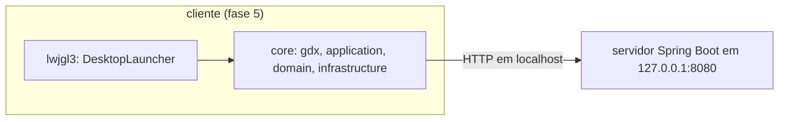
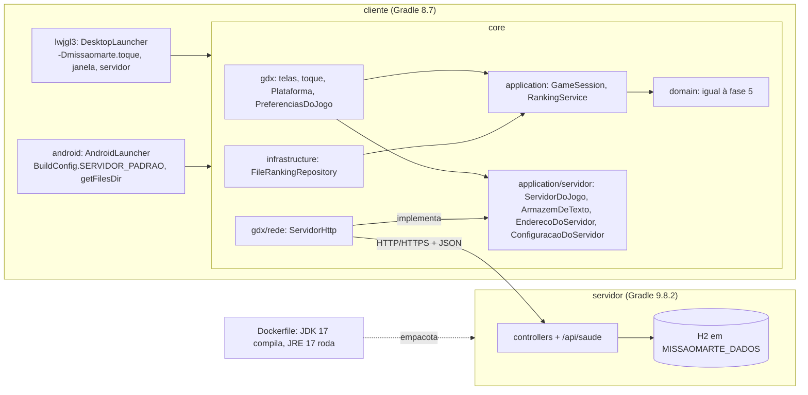

# Tutorial da fase 6: Android, toque e servidor publicável

Na fase 5 o jogo rodava só no desktop, falava com um servidor em `localhost` e o endereço vinha de um `-D` na
linha de comando. Na fase 6 o mesmo `core` roda também num módulo Android, o jogo se controla por toque, o
endereço do servidor se configura dentro do jogo e o servidor ficou pronto para ser publicado (Wi-Fi local ou
contêiner na nuvem).

Os comandos estão no `README.md` da fase; o roteiro de publicação, em `servidor/DEPLOY.md`. As provas foram
feitas no Git Bash com o JDK 17 (Temurin 17.0.21.1), em 21/11/2026, numa máquina **sem o Android SDK**: o que
depende do SDK ou de um aparelho está na seção 8.7.

## 8.1 Estado de origem e destino

| item da Fase 5 | equivalente na Fase 6 |
|---|---|
| módulos `core` e `lwjgl3` | `core`, `lwjgl3` e `android` (este só entra no build quando há SDK) |
| `FitViewport(800, 600)` | o mesmo sem toque; no modo toque, `ExtendViewport(1060, 600)` com a coluna de controles à direita |
| só teclado | teclado, toque (botões virtuais), tecla Voltar do Android e controle Bluetooth |
| endereço do servidor fixo no `-Dmissaomarte.servidor` | tela "Servidor" (opção 6 dos dois menus e `F3` no Entrar): endereço, porta, HTTPS, testar, salvar e restaurar; o `-D` e o `-PservidorPadrao` viram só o padrão |
| nada gravado além do `ranking.json` | `Preferences` com o endereço, a porta e o HTTPS (nada de senha, token ou nome) |
| `ranking.json` na pasta onde o jogo abre | no desktop, igual; no Android, na pasta privada do app (`getFilesDir()`) |
| servidor só em `127.0.0.1:8080` | escuta e porta por variável (`MISSAOMARTE_ENDERECO`, `MISSAOMARTE_PORTA`, `PORT`), `GET /api/saude`, `app.jar`, `Dockerfile` |
| core com `List.of`, `Files.readString` (Java 9 e 11) | core sem essas APIs (o Android 8, API 26, não as tem) |
| 49 testes no servidor e 140 no cliente | 52 no servidor e 267 no cliente |

Antes (fase 5): um jogo desktop e um servidor local.



Depois (fase 6): dois lançadores para o mesmo `core`; o endereço vem das `Preferences`; o servidor pode estar no
PC (Wi-Fi) ou num contêiner.



## 8.2 Conceitos aplicados

**Por que o `core` não conhece a plataforma.** `core` tem o jogo inteiro; `lwjgl3` e `android` só montam as
peças e abrem a janela (composition root). O `DesktopLauncher` lê os `-D` e passa `new Plataforma(toque, false)`;
o `AndroidLauncher` passa `new Plataforma(true, true)` e `BuildConfig.SERVIDOR_PADRAO`. O que muda de uma
plataforma para outra chega como dado ou como interface: o `core` não tem `System.getProperty` nem `android.*`
(critério 5), e `domain`, `application` e `infrastructure` continuam sem `com.badlogic`.

**Como o Android empacota.** O `AndroidManifest.xml` declara a activity de entrada (`MAIN`/`LAUNCHER`, com
`exported="true"`, obrigatório com `targetSdk` 31 ou mais), a única permissão (`INTERNET`), a orientação
(`sensorLandscape`) e o ícone (`@mipmap/ic_launcher`). `minSdk 26` é o aparelho mais antigo aceito (Android 8);
`targetSdk 35` é a versão cujas regras o app segue; `compileSdk 35` é a API usada para compilar. As **ABIs** são as
arquiteturas de processador: o libGDX tem uma biblioteca nativa (`.so`) para cada uma (`armeabi-v7a`,
`arm64-v8a`, `x86`, `x86_64`); o `android/build.gradle` as extrai dos `.jar` para `build/nativas/<abi>` e aponta
`jniLibs.srcDirs` para lá (sem isso o APK abre e fecha). Os **assets** são os mesmos do desktop:
`assets.srcDirs = ['../core/assets']`, sem cópia.

**Linguagem x API.** O compilador com `sourceCompatibility 17` aceita a sintaxe do Java 17 (`switch` com `->`,
`var`), e o Android converte essa sintaxe para o seu formato (desugaring). Mas ele **não cria** métodos que o
Android 8 não tem: `List.of` (Java 9) ou `Files.readString` (Java 11) compilam e quebram só no aparelho. Por isso o
`core` trocou esses usos (lista na seção "Arquivos novos ou alterados") e a busca do critério 6 procura os métodos
mais comuns do Java 9 ao 17. A busca é por lista: prova que esses não aparecem, não que nenhum outro aparece.

**Toque, `unproject`, ponteiros e repetição.** O toque chega em pixels da tela, com o y para baixo.
`TelaBase` (linha 249) chama `viewport.unproject`, que devolve a posição no mundo do jogo (com o y para cima e o
mesmo sistema do desenho), e só então procura o `BotaoVirtual` que contém o ponto. Cada dedo tem um número
(ponteiro). Na partida, apoiar uma seta joga um turno e repete enquanto o **mesmo** ponteiro continua apoiado:
`RepeticaoDoToque` guarda o dono e a ação; soltar outro dedo não para a repetição, soltar o dono para, arrastar o
dono para fora do botão para, e um segundo dedo em outra seta vira o novo dono. `pause()` e `hide()` também param.

**Viewports.** O `FitViewport(800, 600)` mantém 4:3 e põe faixas pretas no que sobra. O `ExtendViewport(1060,
600)` garante um mundo de pelo menos 1060x600 e **estende** o lado que sobrar: numa tela 20:9 o mundo fica com uns
1333x600; em retrato, 1060x1884. O jogo continua em 0..800 x 0..600 e a coluna de controles ocupa de x=800 até a
largura do mundo, então nada do mapa é coberto em nenhuma proporção (capturas 1200x540, 540x960, 800x600 e
1920x1009). A câmera fica no padrão (`update(w, h, true)`): uma câmera centrada no bloco 1060x600 cortaria a
coluna. Sem toque, o jogo usa o `FitViewport` da fase 5, sem mudança.

**HTTP bloqueado no Android.** Desde o Android 9, o padrão é recusar HTTP sem criptografia (cleartext), porque
senha e token iriam legíveis para qualquer um na rede. Aqui o servidor de teste roda no PC, em HTTP; a exceção
vale **só no debug**: o manifesto usa `android:usesCleartextTraffic="${usaHttpSemCriptografia}"`, e o
`android/build.gradle` põe `'true'` no `debug` e `'false'` no `release`. O APK de release só fala HTTPS.

**Variáveis de ambiente, escuta e saúde.** O servidor lê a configuração do ambiente em vez de um arquivo no
repositório: `server.address=${MISSAOMARTE_ENDERECO:127.0.0.1}` e
`server.port=${MISSAOMARTE_PORTA:${PORT:8080}}`. `127.0.0.1` só aceita conexões da própria máquina; `0.0.0.0`
aceita por qualquer interface (Wi-Fi, contêiner). A **verificação de saúde** é uma rota barata que diz "estou no
ar": `GET /api/saude` → `200 {"status":"ok"}`, sem token. O botão Testar conexão chama essa rota, e um provedor de
nuvem a consulta para saber se o contêiner subiu.

**Contêiner e o `Dockerfile`.** Um contêiner é o programa com tudo de que ele precisa (aqui, o JRE e o JAR),
isolado da máquina. Etapa 1 (`eclipse-temurin:17-jdk`): copia o código e roda `sh gradlew bootJar` (o `sh` porque
o `gradlew` está no Git sem o bit de execução). Etapa 2 (`eclipse-temurin:17-jre`): cria o usuário sem privilégio
`missaomarte`, cria `/dados` e passa a pasta para ele (`chown`) **antes** do `VOLUME /dados` (senão o volume nasce
do root e o H2 não grava), copia só o `app.jar`, define `MISSAOMARTE_ENDERECO=0.0.0.0` e `MISSAOMARTE_DADOS=/dados`,
troca para o `USER missaomarte`, `EXPOSE 8080` e roda `java -jar`. O segredo do token não entra na imagem.

**Port and Adapter.** `ArmazemDeTexto` (em `application/servidor`) é uma porta: `ler`, `gravar`, `remover`, sem
saber onde. `PreferenciasDoJogo` (em `gdx`) é o adaptador sobre as `Preferences` do libGDX; nos testes, um armazém
em memória faz o mesmo papel. Do mesmo jeito, `ServidorDoJogo` é a porta da rede e `ServidorHttp` o adaptador
(com o `testarConexao` novo). `EnderecoDoServidor` só conhece a porta: decide a precedência (salvo > padrão do
lançador > `http://localhost:8080`) sem libGDX, e por isso tem teste de unidade.

## 8.3 Decisões e limitações de segurança

O que foi tratado:

- **Endereço validado** antes de virar URL: `ConfiguracaoDoServidor.criar` aceita IPv4 com 4 números de 0 a 255
  (`256.1.1.1` e `1.2.3` recusados) ou nome com rótulos `[A-Za-z0-9-]`, porta de 1 a 65535, e recusa espaço,
  barra, `@` e esquema dentro do endereço. O Testar conexão só recebe `config.url()` de uma configuração válida.
- **O que é gravado:** só `servidor.endereco`, `servidor.porta` e `servidor.https` (prova do critério 11 com as
  chaves do `~/.prefs/missaomarte`). Senha, token e nome da conta ficam só na memória. A caixa de senha nativa
  nunca recebe o valor atual.
- **HTTP só no debug** (`usesCleartextTraffic` true no debug, false no release).
- **Aviso de HTTP fora da rede local:** endereço público com HTTPS desligado mostra "Aviso: HTTP fora da rede
  local. A senha e o token iriam sem criptografia." (captura `f6-03`). Rede local = `localhost`, `127.x`, `10.x`,
  `172.16-31.x`, `192.168.x`.
- **Token ligado ao servidor que o emitiu:** salvar ou restaurar um endereço diferente encerra a sessão
  (captura `f6-12`).
- **`-PservidorPadrao` validado** na raiz do build, antes de virar `BuildConfig`: `http://x/a@b` faz o build falhar
  mesmo sem SDK (critério 8). No jogo, um padrão inválido vira `http://localhost:8080` com aviso no log.

O que **não** foi tratado:

- **HTTPS de ponta a ponta** no caminho do Wi-Fi local (só o do provedor de nuvem, caminho B do `DEPLOY.md`).
- **Força bruta no login:** o servidor não limita tentativas.
- **Assinatura de release:** só o APK de debug (assinado com a chave de debug do SDK).
- **Pontuação falsificada:** o servidor confia no resultado que o cliente envia (vem da fase 5).
- **Dados perdidos na nuvem gratuita:** o H2 em arquivo some sem disco persistente.

## 8.4 Decisões de projeto

**Versões.** libGDX 1.12.1, Gradle 8.7 e Java 17 no cliente (as das fases 3 a 5); Android Gradle Plugin 8.6.1,
`compileSdk`/`targetSdk` 35 e `minSdk` 26; servidor com Gradle 9.8.2 e Spring Boot 4.1.2 (os da fase 5). Há
versões mais novas do libGDX, do Gradle e do AGP; trocar agora obrigaria a refazer o build das fases anteriores
sem ganho para a fase. O AGP 8.6.1 foi escolhido por funcionar com o Gradle 8.7 do projeto (a série 8.6 pede
Gradle 8.7 ou mais).

**Divergência do SDK.** O enunciado supõe o SDK instalado. Nesta máquina ele não existe, e instalá-lo exige aceitar
a licença do Android SDK (`sdkmanager --licenses`), o que é aceite de termos em nome do dono da máquina. A entrega
segue a alternativa do AVA ("APK de debug ou evidência da limitação de ambiente"): build desktop verde, módulo
declarado, provas que não dependem do SDK e a seção 8.7 com o que ficou de fora e como verificar.

**Módulo `android` condicional.** Medido: com o `include 'android'` fixo e sem SDK (ou com `sdk.dir` numa pasta
vazia), o build **inteiro** falha ("SDK location not found"), inclusive o do desktop. O `settings.gradle` só
inclui o módulo quando acha `platforms/android-35` (no `sdk.dir` do `local.properties` ou no `ANDROID_HOME`); sem
isso imprime um aviso e segue com `core` e `lwjgl3`. O `apply plugin: 'java'` ficou só em `core` e `lwjgl3`
porque o plugin `java` não convive com o do Android no mesmo projeto, e o AGP fica só no `plugins {}` do
`android/build.gradle`, para o build do desktop nunca baixá-lo.

**Modo toque no desktop.** `-Dmissaomarte.toque=true` liga os botões e o mouse faz o papel do dedo;
`-Dmissaomarte.janela=LxA` simula paisagem, retrato e 4:3. Foi assim que o toque foi verificado sem aparelho
(seção 8.6). A caixa de texto nativa fica desligada no desktop porque o `getTextInput` do lwjgl3 1.12.1 só chama
`canceled()`: no desktop, tocar no campo o seleciona e o teclado físico digita.

**Servidor com mudanças mínimas.** Uma rota nova (`/api/saude`), a porta pela `PORT`, o nome do JAR, o
`Dockerfile`, o `.dockerignore` e o `DEPLOY.md`. Nenhuma rota da fase 5 mudou e os 49 testes da fase 5 passam sem
alteração (critério 1: o `src/test` só ganhou `SaudeApiTest`). O encerramento gracioso já é o padrão do Spring
Boot 4 e foi só documentado.

**Outras decisões registradas.**

- `ServidorDoJogo.testarConexao` é um método `default` (responde erro); o `ServidorHttp` sobrescreve. Assim o
  servidor falso de `EnvioDaPartidaTest` (fase 5) continua sem mudança.
- `Plataforma.pedirTexto(titulo, textoAtual, ehSenha, resposta)` tem um parâmetro a mais que a spec (o texto
  inicial, para endereço e nome; a senha sempre vai vazia).
- A opção 6 entra por `OpcoesDoMenu.todas()`; `para()` ficou igual, então `OpcoesDoMenuTest` (fase 5) não mudou.
  No desktop sem toque o menu ganhou a linha 6 e o aviso desceu de y=180 para y=165.
- `EntrarTela` ganhou `F3` (servidor) no teclado e no texto de ajuda.
- Os botões do fim de partida (Continuar, Reenviar) ficam na coluna de controles.
- `ConfiguracaoDoServidor.url()` sempre põe a porta (ex.: `https://x:443`).
- Ícone: `tools/GeradorDeIcone.java` desenha por código a nave do jogo sobre um planeta vermelho e grava os 5
  tamanhos; rodar de novo gera os mesmos bytes (critério 7).
- Orientação `sensorLandscape` (enunciado) em vez de "retrato e paisagem" (issue #11): o layout cabe em retrato,
  mas o aparelho não gira. Liberar é trocar uma linha do manifesto.

**Padrões usados.**

| padrão | onde | segue ou só parece |
|---|---|---|
| Port and Adapter | `ArmazemDeTexto` / `PreferenciasDoJogo`; `ServidorDoJogo` / `ServidorHttp` | segue: o `application` só conhece a interface |
| Composition root | `DesktopLauncher` e `AndroidLauncher` montam as peças | segue |
| Template Method | `TelaBase` com os ganchos `desenhar`, `teclaApertada`, `montarBotoes`, `aoTocar`, `voltar` | segue (vem da fase 4; ganhou os ganchos de toque) |
| Value Object | `ConfiguracaoDoServidor` (imutável, `equals`/`hashCode`, validada na criação) | segue |
| Strategy | `Plataforma` com modo toque e caixa nativa | só parece: é uma classe com dois valores, não uma família de implementações |

## 8.5 Passo a passo

1. Pré-condição conferida: `mm-07-servidor` (PR #21) e `mm-09-cliente` (PR #22) com PR aberto. Worktree
   `missao-marte-pi-android` com a branch `mm-10-android` saindo da `origin/mm-09-cliente`.
2. Cópias: o cliente da fase 5 desta branch para `fases/fase-06-android/cliente`; o servidor por
   `git archive origin/mm-07-servidor fases/fase-05-servidor-ranking/servidor`, extraído numa pasta temporária e
   copiado (a `mm-07-servidor` nunca é mesclada aqui). Conferidos por hash; 49 e 140 testes verdes sem mudança.
3. Servidor: `SaudeController` e a rota em `rotasPublicas()`, `SaudeApiTest` (3 testes); `PORT` e `app.jar`;
   `Dockerfile`, `.dockerignore`, `DEPLOY.md` e a seção "Mudanças da fase 6" do `servidor/README.md`.
4. Build do cliente: `settings.gradle` condicional, `build.gradle` raiz com o `java` só em `core` e `lwjgl3` e a
   validação do `-PservidorPadrao`, módulo `android`, `AndroidLauncher`, gerador do ícone.
5. API 26: trocas em `ResultadoTurno`, `PartidaTela` e `FileRankingRepository`.
6. Configuração do servidor (classes sem libGDX e testes), depois os botões, layouts e repetição do toque (sem
   libGDX e com testes), depois as telas com toque, a `ConfigServidorTela`, a `Plataforma` e o viewport por modo.
7. Roteiro na janela com o servidor no ar e capturas; documentos.

Problemas reais e como foram resolvidos:

- **Build inteiro quebrado sem SDK.** Com o módulo incluído e sem SDK, até `:core:test` falhava. Solução: o
  `include 'android'` condicional à pasta `platforms/android-35`.
- **Plugin `java` x plugin do Android.** O `subprojects { apply plugin: 'java' }` da fase 5 aplicaria o `java` ao
  `android` e o AGP recusa. Solução: `configure([project(':core'), project(':lwjgl3')])`.
- **`-PservidorPadrao` inválido só seria pego com SDK.** A validação ficou na raiz do build, que roda sempre.
- **Caixa de texto nativa no desktop.** O `getTextInput` do lwjgl3 só chama `canceled()`. Solução: a `Plataforma`
  do desktop desliga a caixa e o teclado físico digita no campo selecionado.
- **Teste da fase 5 quebraria com o método novo na porta.** O `testarConexao` virou `default` (ver 8.4).
- **Acentos trocados no Git Bash.** A mensagem do `-PservidorPadrao` sai com `?` no lugar dos acentos (o console
  usa cp1252); no PowerShell sai certa. Não é defeito do build.
- **Automação da janela.** Para as capturas, um script PowerShell manda cliques e teclas por `PostMessage` e
  captura com `PrintWindow`. Três tropeços: a janela minimizada tem área 0x0 (o script passou a restaurá-la sem
  roubar o foco); a janela apareceu maximizada numa execução (o script passou a restaurar o tamanho pedido, e a
  captura maximizada virou evidência extra de tela larga); setas mandadas por `PostMessage` sem a marca de tecla
  estendida chegam como teclado numérico e não movem a nave (com `D` move). Os dois últimos são limites da
  automação, não do jogo.

## 8.6 Testes e evidências

### O que cada teste novo cobre

| teste | casos | cobre |
|---|---|---|
| `ConfiguracaoDoServidorTest` | 53 | URL montada, normalização, nomes e IPs válidos e inválidos (`256.1.1.1`, `1.2.3`), `http://x/a@b`, porta 0 e 65536, `deUrl`, redes privadas, aviso de HTTP, igualdade |
| `EnderecoDoServidorTest` | 11 | precedência salvo > padrão > localhost, leitura preguiçosa, salvar, restaurar, valor salvo inválido ignorado, nenhuma chave de senha ou token |
| `FormularioDeServidorTest` | 10 | caracteres aceitos, limites, troca de campo, HTTPS, `definirTexto`, `montar()` com configuração ou mensagem |
| `FormularioDeLoginTextoTest` | 5 | `definirTexto` aplica as regras de digitação a cada caractere; `selecionarCampo` |
| `NomeDoPilotoTest` | 5 | caracteres aceitos, máximo de 20, apagar, `definirTexto` |
| `BotaoVirtualTest` | 3 | `contem(x, y)` dentro, fora e nas bordas |
| `LayoutDosControlesTest` | 15 | 7 botões dentro da coluna, fora do 800x600 e sem sobreposição em 1060x600, 1060x795 (4:3), 1333x600 (20:9), 1600x600 e 1060x1884 (retrato); botões do fim; mínimo de 80 na largura mínima e crescimento até o máximo; mundo menor que o mínimo; toque na borda entre dois botões não cai nos dois |
| `LayoutDeOpcoesTest` | 9 | opções cabem na região sem sobreposição e com o mínimo de 80, a primeira linha fica em cima e os botões dividem a largura, sete linhas numa coluna não cabem nos 600, região fora do jogo e botão estreito recusados |
| `ControleDeToqueTest` | 3 | cada botão vira a `Acao` certa; só as setas repetem |
| `RepeticaoDoToqueTest` | 6 | dono, segundo dedo, soltar outro ponteiro, soltar o dono, parar |
| `TecladoParaAcaoControleTest` | 3 | direcional, `BUTTON_A`/`DPAD_CENTER` embarcam, `BUTTON_B` e `BACK` abortam |
| `ServidorHttpSaudeTest` | 4 | `testarConexao` com `Net` falso: testa o endereço pedido (não o salvo), outro programa respondendo na porta não passa, servidor desligado vira mensagem sem exceção, status de erro vai para a tela |
| `SaudeApiTest` (servidor) | 3 | `/api/saude` 200 sem token com `{"status":"ok"}`; `/api/ranking` sem token continua 401 |

Os 140 testes da fase 5 do cliente e os 49 do servidor continuam **sem alteração** (critério 4: o `diff -r` dos
`src/test` não mostra nenhum arquivo da fase 5 alterado, só arquivos novos).

### Saídas

```text
servidor$ ./gradlew --version          → Gradle 9.8.2, Launcher JVM 17.0.21.1 (Eclipse Adoptium 17.0.21.1+2)
servidor$ ./gradlew clean test         → BUILD SUCCESSFUL in 19s
          soma dos XML                 → 52 0 0 0   (total, ignorados, falhas, erros; fase 5: 49)
servidor$ ./gradlew bootJar            → build/libs/app.jar (59.553.988 bytes)
cliente$  ./gradlew --version          → Gradle 8.7, JVM 17.0.21.1 (Eclipse Adoptium 17.0.21.1+2)
cliente$  ./gradlew clean build        → Aviso: Android SDK com platforms/android-35 não encontrado (...). O módulo android fica fora do build; core e lwjgl3 compilam normalmente.
                                         BUILD SUCCESSFUL in 5s
          soma dos XML do core         → 267 0 0 0  (fase 5, rodada na mesma worktree: 140 0 0 0)
cliente$  ./gradlew help -PservidorPadrao='http://x/a@b'      → sai 1: "Valor inválido em -PservidorPadrao: 'http://x/a@b'. Use http://endereco:porta ou https://endereco:porta, sem caminho, espaço ou @."
cliente$  ./gradlew help -PservidorPadrao=http://10.0.2.2:8080 → sai 0
```

`/api/saude` com o servidor iniciado por variáveis (critério 3 e passos 12 e 13 do roteiro):

```text
$ MISSAOMARTE_DADOS=/tmp/mm6 MISSAOMARTE_ENDERECO=0.0.0.0 PORT=18080 java -jar build/libs/app.jar
  Tomcat started on port 18080 (http) with context path '/'
  Started ServidorApplication in 7.646 seconds
$ curl -s -w ' %{http_code}' http://localhost:18080/api/saude        → {"status":"ok"} 200
$ curl -s -w ' %{http_code}' http://192.168.0.122:18080/api/saude    → {"status":"ok"} 200
$ curl -s -o /dev/null -w '%{http_code}' http://localhost:18080/api/ranking → 401
```

O Windows não pediu liberação no firewall: o curl pelo IP saiu da própria máquina. Outro aparelho na rede não foi
testado (seção 8.7).

### Hash do `domain`

```text
$ cat $(ls) | sha256sum   (em core/src/main/java/br/edu/unifor/missaomarte/domain, fase 5 e fase 6)
fase 5: c4502a4a4d95c664a48fc505bd19b24785e43902678ae00d837940140abc172f
fase 6: c4502a4a4d95c664a48fc505bd19b24785e43902678ae00d837940140abc172f
$ diff -r <domain da fase 5> <domain da fase 6>   → vazio
```

### Capturas do modo toque (`docs/capturas/`)

Servidor da fase 6 no ar (`bootRun` na 8080) e o jogo com `-Dmissaomarte.semente=4 -Dmissaomarte.semaudio=true`.

| captura | o que mostra |
|---|---|
| `f6-01-menu-toque-1200x540.png` | menu no modo toque, 6 botões dentro do 800x600 e a coluna da direita vazia |
| `f6-02-servidor-testar-ok.png` | configuração do servidor: Testar conexão com o servidor no ar, "Conexão OK" |
| `f6-03-servidor-aviso-http-nome-publico.png` | endereço `servidor.invalido` (HTTP, nome público): aviso de HTTP fora da rede local |
| `f6-04-servidor-testar-falha.png` | Testar com esse endereço: "Falha no teste: Não foi possível conectar ao servidor.", sem exceção |
| `f6-05-servidor-ip-invalido-nao-salva.png` | `256.1.1.1` e Salvar: "IP inválido: cada número vai de 0 a 255." e nada salvo |
| `f6-06-servidor-vazio-nao-salva.png` | endereço vazio e Salvar: "Digite o endereço do servidor." e nada salvo |
| `f6-07-servidor-salvo.png` | `127.0.0.1` salvo |
| `f6-08-servidor-mantido-apos-reabrir.png` | depois de fechar e abrir o jogo: "Em uso: http://127.0.0.1:8080" |
| `f6-09-servidor-restaurado.png` | Restaurar padrão: "Padrão restaurado: http://localhost:8080." |
| `f6-10-criar-conta.png`, `f6-11-logado.png` | criar conta pelo toque (senha mascarada) e menu logado |
| `f6-12-troca-de-servidor-encerra-sessao.png` | logado, salvar outro servidor: "Você saiu da conta (o login vale só no servidor antigo)." |
| `f6-13-menu-convidado-apos-troca.png` | o menu volta ao modo convidado |
| `f6-14-nova-partida-toque.png` | Nova partida com os botões (nome da conta, dificuldade, Decolar, Voltar) |
| `f6-15-partida-com-botoes-1200x540.png` | partida em 1200x540 (20:9) com as setas, Embarcar, Som e Abortar na coluna à direita |
| `f6-16-vitoria-so-cliques-fim-de-partida.png` | partida vencida **só com cliques**: 4/4 entregues, 48 pontos, 32 movimentos, 162 s, "Resultado enviado.", botão Continuar |
| `f6-17-ranking-global.png` | resumo da partida e ranking global com a linha do piloto6 |
| `f6-18-menu-540x960.png`, `f6-19-partida-540x960.png` | retrato 540x960: menu e partida inteiros, nada coberto (tudo pequeno) |
| `f6-20-partida-toque-800x600.png` | modo toque em 4:3 (mundo 1060x795) |
| `f6-21-partida-toque-maximizada-1920x1009.png` | janela maximizada (1,9:1): a coluna de controles cresce, o mapa não é coberto |
| `f6-22-menu-sem-toque-800x600.png`, `f6-23-partida-sem-toque-800x600.png` | sem `-Dmissaomarte.toque`: 800x600 e teclado, como na fase 5 (o menu tem a linha 6) |

Nada sensível gravado (critério 11): `grep -cE "eyJ|<senha do roteiro>" /tmp/run6.log` deu `0` nas 304 linhas de
todas as execuções; as chaves do `~/.prefs/missaomarte` foram só `servidor.endereco`, `servidor.https` e
`servidor.porta`.

### O que não teve evidência aqui

A inspeção do APK (manifesto, ABIs, assets, ícone) e a verificação do `usesCleartextTraffic` no manifesto mesclado
do debug e do release dependem do SDK: seção 8.7. O que existe é a declaração, conferida por busca no critério 7.

## 8.7 O que não foi verificado

| o quê | por quê | como verificar |
|---|---|---|
| gerar o APK (`:android:assembleDebug`) | sem Android SDK; instalar exige aceitar a licença | instalar o Android Studio ou as command-line tools, aceitar as licenças, `sdkmanager "platforms;android-35" "build-tools;35.0.0"`, criar `cliente/local.properties` com `sdk.dir=C:/Users/<você>/AppData/Local/Android/Sdk` e rodar `./gradlew :android:assembleDebug` |
| `minSdk`, `targetSdk` e permissões no APK | sem APK | `aapt2 dump badging android/build/outputs/apk/debug/android-debug.apk` (espera `sdkVersion:'26'`, `targetSdkVersion:'35'` e só `android.permission.INTERNET`) |
| as quatro ABIs e os assets no APK | sem APK | `unzip -l android-debug.apk | grep -E "lib/|assets/"` (espera `libgdx.so` em `armeabi-v7a`, `arm64-v8a`, `x86` e `x86_64`, e os PNG e WAV do jogo) |
| `usesCleartextTraffic` true no debug e false no release | sem SDK | `aapt2 dump xmltree --file AndroidManifest.xml android-debug.apk`; para o release, `./gradlew :android:processReleaseMainManifest` e ler `android/build/intermediates/merged_manifests/release/.../AndroidManifest.xml` |
| `BuildConfig.SERVIDOR_PADRAO` com o `-PservidorPadrao` | sem SDK (o `BuildConfig` só é gerado no módulo android) | `./gradlew :android:assembleDebug -PservidorPadrao=http://10.0.2.2:8080` e ler `android/build/generated/source/buildConfig/debug/.../BuildConfig.java` |
| o relatório do lint (inclusive `NewApi` sobre o `core`) | sem SDK | `./gradlew :android:lint`; relatório em `android/build/reports/lint-results-debug.html` |
| o jogo num aparelho ou emulador: instalar, configurar o servidor, entrar, jogar pelos botões, tecla Voltar, senha pela caixa nativa, ícone na tela inicial | sem SDK e sem aparelho | `adb install -r android-debug.apk`; servidor pelo caminho A do `DEPLOY.md` |
| rotação de 180 graus da paisagem e pausa da música em segundo plano no Android | sem aparelho | girar o aparelho de cabeça para baixo; apertar a tecla Início com a música tocando e voltar |
| controle Bluetooth | sem controle | parear o controle e jogar (direcional, `A`, `B`) |
| `docker build` e `docker run` | o Docker não está ligado nesta máquina | os comandos do caminho B do `DEPLOY.md` |
| publicação na nuvem | fora do escopo (conta e gasto) | caminho B do `DEPLOY.md` |
| acesso de outro aparelho pelo Wi-Fi | sem segundo aparelho no teste | caminho A do `DEPLOY.md`: abrir `http://<IP do PC>:8080/api/saude` no navegador do celular |

## 8.8 Limitações e próximos passos

1. **Retrato no aparelho.** O layout já cabe em retrato, mas os botões ficam pequenos e o manifesto trava em
   paisagem. Próximo passo: um layout de retrato com os controles embaixo do mapa (a fase 7 poderia escolher
   isto como melhoria de interface).
2. **HTTPS com certificado próprio no Wi-Fi local.** Hoje o caminho A é HTTP (só em rede de confiança). Um
   certificado autoassinado instalado no aparelho tiraria a exceção do debug.
3. **Assinatura e publicação do aplicativo.** Gerar uma chave de release, assinar o APK (ou o AAB) e publicar,
   com o `usesCleartextTraffic` já desligado no release.
4. **Reenvio offline.** Se o envio da partida falha, o jogador precisa tocar em Reenviar na hora; guardar a
   partida e reenviar depois seria uma melhoria da fase 7.
5. **Ranking por dificuldade.** O servidor já guarda a dificuldade; falta a rota e a tela.
6. **Layout para tablets.** Em telas grandes os botões crescem até 120 unidades; um limite em dp deixaria o
   tamanho físico constante.
7. **O relógio da partida conta em segundo plano.** Pausar o tempo junto com a música evitaria a partida
   "andar" com o jogo minimizado.

## Roteiro mínimo de validação (15 passos do enunciado)

| passo | resultado | evidência |
|---|---|---|
| 1. `gradlew --version` em cada subprojeto | servidor: Gradle 9.8.2, JVM 17.0.21.1; cliente: Gradle 8.7, JVM 17.0.21.1 | 8.6 Saídas |
| 2. `gradlew test` (servidor) e `gradlew clean build` (cliente) | `BUILD SUCCESSFUL`: 52 testes no servidor e 267 no cliente, 0 falhas | 8.6 Saídas |
| 3. desktop sem toque em 800x600 como na fase 5 | ok: 800x600, teclado, o menu ganhou a linha 6 | `f6-22`, `f6-23` |
| 4. desktop com toque, partida vencida só com cliques | ok: 4/4 no Fácil, 48 pontos, 32 movimentos, resultado enviado | `f6-15`, `f6-16`, `f6-17` |
| 5. Testar conexão: sucesso e endereço inexistente | ok: "Conexão OK" e "Falha no teste: Não foi possível conectar ao servidor.", sem exceção | `f6-02`, `f6-04` |
| 6. aviso de HTTP com nome público; vazio ou IP inválido não salvam | ok: aviso; "Digite o endereço do servidor." e "IP inválido..."; `~/.prefs/missaomarte` não existia depois | `f6-03`, `f6-05`, `f6-06` |
| 7. salvar, fechar e abrir; Restaurar padrão | ok: `127.0.0.1` mantido depois de reabrir; restaurar voltou a `localhost:8080` e esvaziou as Preferences | `f6-07`, `f6-08`, `f6-09` |
| 8. trocar de servidor logado encerra a sessão | ok: "Você saiu da conta" e menu de convidado | `f6-12`, `f6-13` |
| 9. `:android:assembleDebug` e `aapt2 dump badging` | **não verificado**: sem Android SDK (aceite de licença) | 8.7 |
| 10. `usesCleartextTraffic` true no debug e false no release | **não verificado** no APK: sem SDK; declarado no manifesto e nos `buildTypes` (critério 7) | 8.7 |
| 11. `-PservidorPadrao` inválido falha; válido aparece em `BuildConfig` | parcial: inválido sai 1 e válido sai 0 sem SDK; o `BuildConfig` **não verificado** (só existe com o SDK) | 8.6 Saídas, 8.7 |
| 12. `/api/saude` sem token e `/api/ranking` 401 | ok: `{"status":"ok"} 200` e `401` | 8.6, `SaudeApiTest` |
| 13. escuta em todas as interfaces e outra porta por variável, por `localhost` e pelo IP | ok: porta 18080 por `PORT`, `0.0.0.0` por `MISSAOMARTE_ENDERECO`, 200 em `localhost` e em `192.168.0.122` | 8.6 |
| 14. `com.badlogic` só em `gdx`, `lwjgl3` e `android`; `domain`, fases anteriores e `exercicio10/src` sem mudança | ok: busca vazia em `domain`, `application` e `infrastructure`; hash do `domain` igual; `git diff --name-only` só mostra a fase 6 e a linha do README da raiz; `exercicio10/src` não existe no repositório da equipe (não se aplica) | 8.6, critério 12 |
| 15. no celular | **não verificado**: sem aparelho e sem SDK | 8.7 |

## Arquivos novos ou alterados em `application`, `infrastructure` e `gdx`

`domain` não mudou (hash acima).

| arquivo | camada | novo ou alterado | por quê |
|---|---|---|---|
| `application/ResultadoTurno.java` | application | alterado | `List.of()` → `Collections.emptyList()` (API 26) |
| `application/servidor/ArmazemDeTexto.java` | application | novo | porta de armazenamento de texto (`ler`, `gravar`, `remover`) |
| `application/servidor/ConfiguracaoDoServidor.java` | application | novo | endereço, porta e HTTPS validados, `url()`, rede local e aviso |
| `application/servidor/EnderecoDoServidor.java` | application | novo | precedência salvo > padrão > localhost; grava só as três chaves |
| `application/servidor/ServidorDoJogo.java` | application | alterado | `testarConexao` (`default`, para o falso da fase 5 não mudar) |
| `infrastructure/FileRankingRepository.java` | infrastructure | alterado | `Files.readString`/`writeString` (Java 11) → `readAllBytes`/`write` com UTF-8 (API 26) |
| `gdx/BotaoVirtual.java` | gdx | novo | botão da tela: id, rótulo, retângulo, `contem` |
| `gdx/LayoutDosControles.java` | gdx | novo | onde ficam os 7 botões da partida e os do fim, em qualquer proporção |
| `gdx/LayoutDeOpcoes.java` | gdx | novo | botões dos menus e formulários dentro do 800x600 |
| `gdx/ControleDeToque.java` | gdx | novo | botão → `Acao`; só as setas repetem |
| `gdx/RepeticaoDoToque.java` | gdx | novo | repetição pelo dedo dono |
| `gdx/NomeDoPiloto.java` | gdx | novo | regra de digitação do nome, tirada da `NovaPartidaTela` para servir à caixa nativa |
| `gdx/FormularioDeServidor.java` | gdx | novo | campos da tela do servidor e `montar()` |
| `gdx/ConfigServidorTela.java` | gdx | novo | a tela "Servidor" |
| `gdx/Plataforma.java` | gdx | novo | modo toque e caixa de texto nativa |
| `gdx/PreferenciasDoJogo.java` | gdx | novo | adaptador do `ArmazemDeTexto` sobre as `Preferences` |
| `gdx/TelaBase.java` | gdx | alterado | toque com `unproject`, botões por tela, tecla Voltar, pausa e retomada |
| `gdx/MissaoMarteGame.java` | gdx | alterado | recebe a `Plataforma` e o padrão do servidor; viewport por modo; cria `PreferenciasDoJogo` e `EnderecoDoServidor` no `create` |
| `gdx/MenuTela.java`, `gdx/OpcoesDoMenu.java` | gdx | alterado | opção 6 e botões |
| `gdx/NovaPartidaTela.java` | gdx | alterado | botões, `NomeDoPiloto`, caixa nativa |
| `gdx/EntrarTela.java`, `gdx/FormularioDeLogin.java` | gdx | alterado | botões, caixa nativa (`definirTexto`, `selecionarCampo`), `F3` |
| `gdx/PartidaTela.java` | gdx | alterado | botões da partida, repetição por toque, Voltar; `List.of(x)` → `Collections.singletonList(x)` |
| `gdx/RankingTela.java`, `gdx/HistoricoTela.java` | gdx | alterado | botões Recarregar e Voltar |
| `gdx/TecladoParaAcao.java` | gdx | alterado | controle Bluetooth e `BACK` |
| `gdx/TocadorDeSom.java` | gdx | alterado | pausa em segundo plano e retomada só se tocava antes |
| `gdx/rede/ServidorHttp.java` | gdx | alterado | `testarConexao` (`GET /api/saude`) com a URL de uma configuração validada; o endereço das outras chamadas já era lido a cada chamada desde a fase 5 e agora vem do `EnderecoDoServidor` |

Fora dessas camadas: `lwjgl3/DesktopLauncher.java` e `lwjgl3/build.gradle` (`-Dmissaomarte.toque` e
`-Dmissaomarte.janela`), o módulo `android` inteiro, `tools/GeradorDeIcone.java`, `settings.gradle`, `build.gradle`
e `.gitignore` do cliente.
