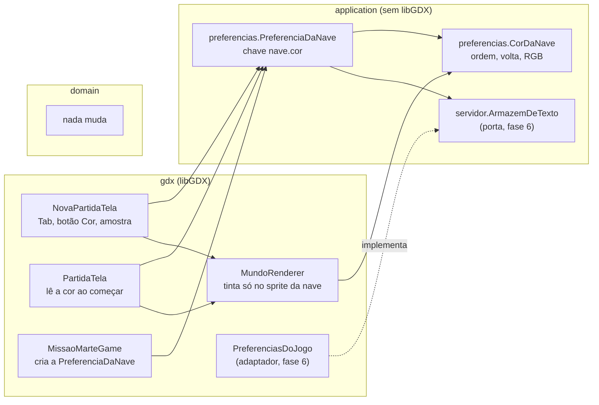

# Tutorial da fase 7: melhoria própria, cor da nave

Base: a fase 6 da equipe (`fases/fase-06-android`), copiada para esta pasta sem mudança no primeiro commit da
fase. O escopo da melhoria (`docs/escopo-da-melhoria.md`) foi escrito e commitado antes de qualquer código.

A referência do professor tem, na fase 7, um modo dinâmico, o tiro e 208 testes. Esta fase **não** parte dela:
o enunciado do AVA manda não copiar o código de referência, então a base é o jogo da equipe, que segue por turnos,
sem modo dinâmico e sem tiro. A pasta `exercicio10/src` citada no enunciado não existe neste repositório:
"não se aplica".

## 8.1 A melhoria

**O que o jogador passa a poder fazer.** Escolher a cor da nave na tela de Nova partida:

- no teclado, `Tab` passa para a próxima cor (Original, Vermelha, Verde, Azul, Amarela, Rosa e de novo Original);
- no modo toque (Android, ou `-Dmissaomarte.toque=true` no desktop), o botão **Cor da nave: <cor>** faz o mesmo;
- ao lado da escolha aparece uma nave de exemplo já pintada na cor;
- na partida, a nave aparece na cor escolhida;
- a escolha fica guardada: a próxima Nova partida, e o jogo aberto de novo, já começam na última cor.

Quem nunca escolheu vê a cor Original, que é o sprite sem tinta: o jogo fica igual ao da fase 6.

**Por que esta melhoria.** Está na lista de melhorias de nível básico do enunciado (F7, 5.1), cabe no prazo da
Sprint 4 e mexe nas camadas certas sem tocar nas regras: usa a porta de armazenamento que a fase 6 criou para o
endereço do servidor e o desenho por símbolo do `MundoRenderer`. Não acrescenta sorteio, então os cenários da
mesma semente continuam iguais (F7, seção 6, "Sorteios"), e funciona nos dois modos de controle que a fase 6
deixou (teclado e toque).

## 8.2 Diagnóstico e decisões de arquitetura

### Pontos de extensão usados

| ponto de extensão (fase 6) | como foi usado |
|---|---|
| Porta `ArmazemDeTexto` e o adaptador `PreferenciasDoJogo` | a `PreferenciaDaNave` lê e grava a chave `nave.cor` pela porta; no jogo ela cai nas mesmas Preferences do endereço do servidor; nos testes, num mapa em memória |
| `MundoRenderer.desenharNave` (a nave já tinha um método só dela, escolhido pelo símbolo `@`) | a tinta entra num lugar só, sem tocar no `domain` nem no `simbolo()` |
| `LayoutDeOpcoes` (botões do modo toque) | o botão Cor é mais uma linha da Nova partida (4 linhas cabem nos 430 de altura com o mínimo de 80) |
| `TelaBase.rotulo(botao)` | o texto do botão mostra a cor atual, como o botão do nome já mostrava o nome digitado |

### O que não servia como estava

- **O nome do pacote da porta.** `ArmazemDeTexto` mora em `application/servidor`, um nome que diz "servidor",
  mas a porta é genérica (texto por chave). Mover a interface mudaria arquivos da fase 6 sem ganho para o jogador,
  então a `PreferenciaDaNave` importa a porta de lá e o acoplamento de nome fica registrado aqui.
- **A amostra da Nova partida.** A Nova partida não tinha acesso ao desenho da nave (ele era privado do
  `MundoRenderer`). O desenho tingido virou um método estático do `MundoRenderer`
  (`desenharNaveColorida`), usado pela partida e pela amostra, para a tinta ter uma regra só.
- **A sequência da semente 4.** O "4/4 e 30 movimentos" do roteiro (F7, seção 9, passo 3) é do mapa do professor;
  no mapa da equipe a mesma sequência não vence (ver 8.4). O teste de compatibilidade protege o resultado medido
  na base, não o do enunciado.

### Em que camada cada parte ficou



- **`application/preferencias`:** a regra da cor (a ordem, a volta, qual é o padrão, como se lê e se grava, o
  que fazer com um valor inválido) é testável sem janela, então fica fora do `gdx`. A cor é guardada como três
  números de 0 a 1; a `Color` do libGDX só aparece no `gdx`.
- **`gdx`:** só traduz a tecla e o toque em `proxima()`, a cor em `batch.setColor` e a escolha em `salvar`.
- **`domain`:** a cor não é regra do jogo (não muda pontuação, colisão nem vitória), então a `Nave` não sabe dela.
- **`infrastructure`:** nada novo; o armazenamento já existe (Preferences da fase 6).

Integração com a sessão (F7, 5.3: eventos, pontuação, estado): **não se aplica**. A cor não entra na
`GameSession`, na `Missao` nem no `Random`; o `PartidaSemente4Test` prova que a partida da semente 4 continua
com o mesmo resultado.

### Padrões

| padrão | onde | segue de fato? |
|---|---|---|
| Porta e adaptador (hexagonal) | `ArmazemDeTexto` (porta, em `application`) e `PreferenciasDoJogo` (adaptador, em `gdx`); a `PreferenciaDaNave` depende só da porta | **sim**: a regra não conhece o libGDX, e o teste troca o adaptador por um mapa em memória |
| Enum com comportamento | `CorDaNave.proxima()` e `padrao()` | **sim**: a ordem e a volta moram na própria enum, não num `switch` na tela |
| Repositório | `PreferenciaDaNave` | **só parece**: lê e grava um valor por chave, mas não é coleção de entidades nem tem consulta; é um invólucro de uma preferência |
| Strategy | a tinta por cor | **não é**: as cores são dados (três números), não comportamentos trocáveis; uma `Strategy` aqui seria cerimônia sem ganho |

## 8.3 Passo a passo

1. `git worktree add ... -b mm-13-melhoria mm-10-android`: a fase 7 começou da branch local da fase 6 enquanto a
   fase 6 ainda fechava o PR dela (base `mm-10-android`, como manda a pilha de PRs).
2. Cópia da fase 6 por `git archive HEAD fases/fase-06-android/cliente fases/fase-06-android/servidor`, extraída
   numa pasta temporária e copiada para cá (só arquivos versionados: sem `build`, `.gradle`, `dados`,
   `local.properties`). `diff -r` contra a fase 6 vazio; `./gradlew clean build` no cliente (267 testes, a conta
   da fase 6 naquele momento) e `./gradlew clean test` no servidor (52), verdes. Commit da cópia.
3. `docs/escopo-da-melhoria.md`, sozinho num commit, antes de qualquer código (MM-13).
4. `PartidaSemente4Test`, escrito e rodado contra a cópia **sem nenhuma mudança** de código: passou com 2 de 4
   entregues, 25 pontos, 30 movimentos, 2 vidas e partida sem fim. Commit. O teste não mudou até o fim da fase
   (`git log` do arquivo tem 1 commit).
5. `CorDaNave`, `PreferenciaDaNave` e os 11 testes. Commit.
6. A tela, o desenho e o jogo: `NovaPartidaTela` (`Tab`, botão, amostra), `MundoRenderer` (tinta),
   `PartidaTela` (lê a cor) e `MissaoMarteGame` (cria a preferência). Commit.
7. **Problema real:** no meio do caminho, a fase 6 recebeu, na revisão do PR dela, duas correções (toque
   cancelado, espera no fim da partida e endereço recusado na caixa nativa; 267 → 269 testes). Elas estavam só em
   `fases/fase-06-android`, e a cópia da fase 7 tinha nascido antes. Solução, sem rebase nem `--force`:
   `git merge origin/mm-10-android`; os arquivos que a fase 7 não tinha alterado foram trocados pela versão nova
   da fase 6 e conferidos com `diff -r` (sobrou só o que a melhoria mudou); a `PartidaTela`, que a fase 7 tinha
   alterado, recebeu o mesmo trecho por `git apply` do diff da fase 6. Cliente com 281 testes. Commit.
8. **Problema real (ferramenta):** a primeira tentativa de editar os arquivos por script falhou com "texto não
   encontrado": a cópia de trabalho tem fim de linha CRLF (o `autocrlf` do Windows) e o script procurava `\n`.
   O script passou a detectar o CRLF antes de trocar.
9. **Problema real (conferência):** na troca do passo 7, a primeira conferência "a fase 7 alterou este arquivo?"
   acusou todos os arquivos, porque comparava com um commit em que a pasta da fase 7 nem existia. Refeita contra
   o commit da cópia, mostrou que nenhum dos arquivos trocados tinha sido alterado pela melhoria.
10. Jogo aberto em 800x600 sem toque, 1200x540 e 540x960 com toque; capturas em `docs/capturas/`. Valor inválido
    gravado à mão nas Preferences para ver o padrão voltar.
11. README, este tutorial e a linha da fase 7 no README da raiz. Commit.

## 8.4 Testes e evidências

### O que cada teste novo cobre

| teste | casos |
|---|---|
| `CorDaNaveTest` (6) | a ordem das cores; a primeira é a Original e é o `padrao()`, com RGB 1, 1, 1; `proxima()` segue a ordem e, depois da última, volta à primeira; percorrer todas volta ao começo; nomes em português; componentes entre 0 e 1 e só a Original sem tinta |
| `PreferenciaDaNaveTest` (5) | sem valor gravado vale a Original; salvar e ler (e ler de novo com outra instância sobre o mesmo armazém, como depois de fechar e abrir); valores inválidos (`""`, espaços, `roxa`, `azul` minúsculo, `AZUL ` com espaço, `Azul`, `7`) voltam à Original; grava só a chave `nave.cor`, com o nome da constante; não mexe nas chaves do servidor |
| `PartidaSemente4Test` (1) | compatibilidade: a sequência `wwdwdwewedsdseaasasasasasasedwdwdw` (F7, seção 7), cada letra convertida pelo `TecladoParaAcao` como na tela (o `e` é EMBARCAR), um único `Random(4)` para a fábrica e para a sessão, como no lançador, mapa 5 e Fácil: 2 de 4 entregues, 25 pontos, 30 movimentos, 2 vidas, nenhum a bordo, partida sem fim. Medido na cópia da fase 6 antes da melhoria |

Os 269 testes da fase 6 continuam sem alteração (`diff -r ../../fase-06-android/cliente/core/src/test
core/src/test` só mostra os arquivos novos). A tela e o desenho não têm teste de unidade (dependem de uma janela
OpenGL); a lógica deles fica nas duas classes de `application`, que têm.

### Saídas (`bash tarefas/.../provas-b.sh`, 21/11/2026)

```text
== cliente (fases/fase-07-evolucao-livre/cliente)
Gradle 8.7
clean build exit 0
BUILD SUCCESSFUL in 4s
soma cliente: 281 0 0 0          (testes, ignorados, falhas, erros; 269 da fase 6 + 12 novos)
diff testes (vazio acima = ok)

== servidor (fases/fase-07-evolucao-livre/servidor)
Gradle 9.8.2
Launcher JVM:  17.0.21.1 (Eclipse Adoptium 17.0.21.1+2)
test exit 0
BUILD SUCCESSFUL in 17s
soma servidor: 52 0 0 0
diff servidor (vazio acima = ok)  (diff -r ../../fase-06-android/servidor . -x build -x .gradle -x dados)

== camadas
domain (vazio = ok)
infrastructure (vazio = ok)
Only in core/src/main/java/br/edu/unifor/missaomarte/application: preferencias
com.badlogic fora de gdx (vazio = ok)
PartidaSemente4Test: tests="1" skipped="0" failures="0" errors="0"
CorDaNaveTest: tests="6" skipped="0" failures="0" errors="0"
PreferenciaDaNaveTest: tests="5" skipped="0" failures="0" errors="0"
commits no PartidaSemente4Test: 1
```

### Comparação do modo clássico com a base

- **Regras:** a mesma sequência da semente 4 dá o mesmo resultado na base copiada e no código final (o teste foi
  escrito antes da melhoria e não mudou).
- **Tela sem toque, 800x600:** o menu, a partida e o fim de partida não mudaram. A Nova partida ganhou a linha
  "Cor da nave: <cor> (Tab troca)" com a amostra ao lado; as outras linhas ficaram nos mesmos lugares. Com a cor
  Original, a partida fica como na fase 6 (captura `09`): a tinta branca multiplica o sprite por 1.
- **Tela com toque:** a Nova partida passou de 3 para 4 linhas de botões (o Decolar desceu uma linha).

### Capturas (`docs/capturas/`)

| arquivo | janela | o que mostra |
|---|---|---|
| `01-nova-partida-azul-800x600.png` | 800x600 sem toque | Nova partida depois de 3 `Tab`: Azul, com a amostra azul |
| `02-partida-nave-azul-800x600.png` | 800x600 sem toque | a partida com a nave azul; propulsor, passageiros, perigos e base sem tinta |
| `03-cor-mantida-ao-reabrir-toque-1200x540.png` | 1200x540 com toque | o jogo fechado e aberto de novo: a Nova partida já começa em Azul |
| `04-botao-cor-amarela-toque-1200x540.png` | 1200x540 com toque | um clique no botão Cor: Amarela |
| `05-partida-nave-amarela-toque-1200x540.png` | 1200x540 com toque | a partida com a nave amarela e os botões da fase 6 |
| `06-botao-cor-rosa-toque-540x960.png` | 540x960 com toque | retrato: o botão Cor em Rosa, nada fora da tela nem sobreposto |
| `07-partida-nave-rosa-toque-540x960.png` | 540x960 com toque | retrato: a partida com a nave rosa |
| `08-valor-invalido-volta-original-800x600.png` | 800x600 sem toque | `nave.cor` trocado à mão para `ROXA` nas Preferences: a Nova partida abre na Original, sem erro no log |
| `09-partida-nave-original-800x600.png` | 800x600 sem toque | a partida com a cor Original, igual à fase 6 |

Gravação conferida no arquivo: depois dos 3 `Tab` da captura `01`, ainda na Nova partida e antes de decolar,
`~/.prefs/missaomarte` já tinha `<entry key="nave.cor">AZUL</entry>`. As chaves gravadas continuam só
`servidor.endereco`, `servidor.porta`, `servidor.https` e `nave.cor`
(`grep -o 'key="[^"]*"' ~/.prefs/missaomarte | grep -vE 'key="(servidor\.(endereco|porta|https)|nave\.cor)"'`
vazio).

### `com.badlogic` continua restrito

`grep -rln "com.badlogic" core/src/main/java/br/edu/unifor/missaomarte/{domain,application,infrastructure}`
vazio; `CorDaNave` e `PreferenciaDaNave` não importam nada do libGDX.

## 8.5 O que não foi verificado

- **APK e aparelho:** não há Android SDK nesta máquina, e instalá-lo exige aceitar a licença do SDK. O
  `:android:assembleDebug`, a instalação e o botão Cor com o dedo num celular real ficam não verificados (os
  comandos estão no tutorial da fase 6, 8.7).
- **Modo logado:** a cor foi testada no modo convidado. No logado a Nova partida é a mesma tela (só o nome vem da
  conta) e a cor não passa pelo servidor, mas não houve partida logada com cor.
- **Áudio:** os testes de tela rodaram com `-Dmissaomarte.semaudio=true`; o som de seleção ao trocar de cor não foi
  ouvido.
- **Jogo do início ao fim com cor:** as partidas com cor foram abertas e abortadas; a vitória colorida não foi
  jogada até o fim (o desenho da nave é o mesmo em toda a partida).
- **Contraste e daltonismo:** as cores foram escolhidas a olho sobre o terreno marrom; não houve teste de
  contraste nem com pessoas daltônicas.
- **Controle Bluetooth:** a troca de cor não tem botão no controle; não testado.

## 8.6 Limitações e próximos passos

1. **A nave do menu principal** continua na cor original; pintá-la também deixaria a escolha visível desde a
   abertura.
2. **Acessibilidade:** a amostra é pequena (40 px no modo toque) e fica sobre o planeta do fundo; as cores
   poderiam ter também um padrão ou um nome maior para quem não distingue bem as cores.
3. **Mais personalização:** a mesma `PreferenciaDaNave` poderia guardar o rastro do propulsor ou um sprite
   alternativo; hoje só a cor existe.
4. **Ranking:** o servidor não sabe da cor; mostrar a nave colorida ao lado do nome no ranking global pediria um
   campo novo na API (fora do escopo de uma melhoria que não muda o servidor).
5. **Nome do pacote da porta:** mover `ArmazemDeTexto` para um pacote neutro (ex.: `application/armazem`)
   tiraria o acoplamento de nome com `servidor`, ao custo de mexer em arquivos da fase 6.
6. **Botão do controle:** um botão do controle Bluetooth para trocar de cor, como o `A` e o `B` da fase 6.

## Roteiro mínimo de validação (F7, seção 9)

| passo | resultado |
|---|---|
| 1. `gradlew --version` | cliente: Gradle 8.7, JVM 17; servidor: Gradle 9.8.2, JVM 17.0.21.1 (Eclipse Adoptium) |
| 2. `gradlew test` (servidor) e `gradlew clean build` (cliente) | `BUILD SUCCESSFUL` nos dois: servidor 52 testes, cliente 281, sem falha |
| 3. Semente 4 no modo clássico | a sequência do enunciado não vence no mapa da equipe: 2 de 4 entregues, 25 pontos, 30 movimentos, 2 vidas, igual na base e no final (`PartidaSemente4Test`). O "4/4" do enunciado é do mapa do professor; o 4/4 do tutorial da fase 4 é de uma partida jogada à mão, não desta sequência |
| 4. 800x600 sem toque com o layout da base | menu, partida e fim iguais; a Nova partida tem a linha nova da cor (capturas `01`, `08`, `09`) |
| 5. `-Dmissaomarte.toque=true` com o mouse | o botão Cor troca a cor e a partida usa a escolhida (capturas `04`, `05`) |
| 6. Duas proporções de janela | 1200x540 (capturas `03` a `05`) e 540x960 (capturas `06` e `07`), sem nada fora da tela nem sobreposto |
| 7. Casos limite | depois da Rosa volta a Original (`CorDaNaveTest`); valor ausente ou estragado vale a Original sem erro (`PreferenciaDaNaveTest` e captura `08`); a troca grava na hora, sem precisar decolar (conferido no arquivo); a cor não muda durante a partida (só a Nova partida a troca; a partida lê a cor ao começar); ao terminar a partida e começar outra, a cor continua (lida de novo das Preferences) |
| 8. `gradlew :android:assembleDebug` | não verificado: sem Android SDK nesta máquina (8.5) |
| 9. `com.badlogic` fora de `gdx`, `lwjgl3` e `android` | busca vazia (8.4) |
| 10. Fases anteriores intactas | `git diff --name-only origin/mm-10-android...HEAD` só mostra `fases/fase-07-evolucao-livre/` e a linha da fase 7 no `README.md` da raiz |
| 11. Aparelho | não verificado: sem SDK e sem aparelho |

## Arquivos novos ou alterados em `domain`, `application` e `infrastructure`

| camada | arquivo | por quê |
|---|---|---|
| `domain` | nenhum | a cor não é regra do jogo (`diff -r` com a fase 6 vazio) |
| `application` | `preferencias/CorDaNave.java` (novo) | as cores, a ordem, a volta e o padrão, testáveis sem janela |
| `application` | `preferencias/PreferenciaDaNave.java` (novo) | ler e gravar a escolha pela porta `ArmazemDeTexto`, com o padrão para valor ausente ou inválido |
| `infrastructure` | nenhum | o armazenamento já existia (Preferences da fase 6, adaptador em `gdx`) |

Em `gdx`, alterados: `NovaPartidaTela`, `MundoRenderer`, `PartidaTela` e `MissaoMarteGame` (tabela em
`docs/escopo-da-melhoria.md`).
